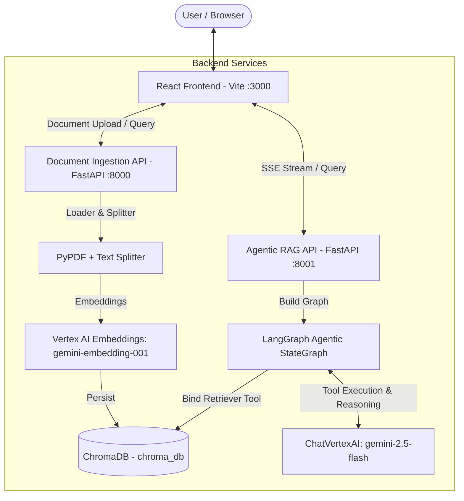

# Interactive RAG: Agentic Vector Store Manager & AI Assistant

An end-to-end **Agentic Retrieval-Augmented Generation (RAG)** platform powered by **LangGraph**, **Gemini 2.5 Flash**, **ChromaDB**, **FastAPI**, and **React (Vite)**. 

Interactive RAG enables dynamic vector store collection management, multi-PDF document ingestion, similarity searching, and real-time streaming agentic decision-making with tool-calling capabilities.

---

## 🌟 Key Features

- 🧠 **LangGraph Agentic Workflow**: Uses Gemini 2.5 Flash as an agentic controller capable of reasoning, determining when document context is needed, invoking collection-specific retriever tools, and synthesizing precise answers.
- 📚 **Dynamic Vector Store Management**: Manage multiple persistent Chroma collections (`chroma_db`), upload custom PDF documents, and configure chunking parameters (`chunk_size`, `chunk_overlap`) dynamically.
- ⚡ **Real-Time SSE Streaming**: Stream agent execution states and tool calls live to the UI using Server-Sent Events (SSE).
- 🔍 **Interactive Stream Inspector**: Frontend includes both `pretty_print_event` formatted logs and raw JSON event inspectors for deep debugging into LLM tool invocations.
- 🎨 **Modern React Dashboard**: Sleek, glassmorphic dark-mode web application built with React, Vite, and Lucide Icons for collection switching, drag-and-drop PDF uploading, semantic querying, and chat interactions.
- 📄 **Multi-PDF Parsing**: PyPDF integration with `RecursiveCharacterTextSplitter` and Google Vertex AI Embeddings (`gemini-embedding-001`).

---

## 📁 Repository Structure

```
InteractiveRAG/
├── data/                       # Sample PDF documents for vector store ingestion
│   ├── google-2024-annual-report.pdf
│   ├── google-2025-annual-report.pdf
│   ├── Stock_Market_Performance_2024.pdf
│   ├── Stock_Market_Performance_2025.pdf
│   └── uploads/                # Directory for user-uploaded PDF files (.gitkeep)
├── frontend/                   # Vite + React Frontend Application
│   ├── src/
│   │   ├── App.jsx             # Main interactive dashboard component
│   │   ├── index.css           # Glassmorphism styling system & CSS variables
│   │   └── main.jsx            # React root mounting script
│   ├── package.json            # Node.js dependencies
│   └── vite.config.js          # Vite build configuration (Port 3000)
├── src/                        # Core Python Backend Modules
│   ├── add_documents.py        # PDF ingestion service & Document Ingestion API (Port 8000)
│   └── agentic_rag.py          # LangGraph RAG Agent & Streaming Assistant API (Port 8001)
├── tests/                      # Integration and module test scripts
│   ├── add_documents.py        # Ingestion service test suite
│   └── agentic_rag.py          # Agentic RAG graph test suite
├── utils/                      # Shared helper utilities
│   ├── logging.py              # Colored logging configuration
│   └── messages_pretty_print.py# Event stream pretty printer for terminal & API output
├── requirements.txt            # Python dependencies
└── README.md                   # Project documentation
```

---

## 🛠️ System Architecture



---

## 📋 Prerequisites

1. **Python**: 3.10+ (Tested on Python 3.13)
2. **Node.js**: 18+ and npm
3. **Google Cloud Credentials**: Access to Vertex AI API (`gemini-2.5-flash` and `gemini-embedding-001`).
   Ensure Application Default Credentials (ADC) are configured:
   ```bash
   gcloud auth application-default login
   ```
   Or set the environment variable:
   ```bash
   export GOOGLE_APPLICATION_CREDENTIALS="/path/to/your/credentials.json"
   export GOOGLE_CLOUD_PROJECT="your-gcp-project-id"
   ```

---

## 🚀 Quick Start Guide

### 1. Clone & Set Up Python Environment

```bash
# Initialize virtual environment
python3 -m venv .venv
source .venv/bin/activate

# Install backend dependencies
pip install -r requirements.txt
```

### 2. Install Frontend Dependencies

```bash
cd frontend
npm install
cd ..
```

---

## 🏃 Running the Services

Launch the backend services and frontend web application across separate terminal sessions:

### Terminal 1: Document Ingestion API (Port 8000)
```bash
source .venv/bin/activate
python -m src.add_documents
```
*Runs FastAPI on `http://localhost:8000`*

### Terminal 2: Agentic RAG Assistant API (Port 8001)
```bash
source .venv/bin/activate
python -m src.agentic_rag
```
*Runs FastAPI on `http://localhost:8001`*

### Terminal 3: React Frontend Dashboard (Port 3000)
```bash
cd frontend
npm run dev
```
*Opens Vite Dev Server on `http://localhost:3000`*

---

## 📡 API Reference

### Document Ingestion API (`:8000`)

| Endpoint | Method | Description |
| :--- | :--- | :--- |
| `/collections` | `GET` | List all Chroma vector store collections and item chunk counts. |
| `/collections/{collection_name}` | `DELETE` | Delete an existing Chroma vector store collection by name. |
| `/add_documents` | `POST` | Ingest local PDF paths into a vector collection. |
| `/upload_pdf` | `POST` | Upload single/multiple PDF files via `multipart/form-data` and ingest into a collection. |
| `/query` | `POST` | Similarity search on a vector collection returning top `k` chunks with metadata. |

#### Example Upload & Ingest Request:
```bash
curl -X POST "http://localhost:8000/upload_pdf" \
  -F "files=@data/Stock_Market_Performance_2024.pdf" \
  -F "collection_name=stock_market_vs"
```

---

### Agentic RAG API (`:8001`)

| Endpoint | Method | Description |
| :--- | :--- | :--- |
| `/collections` | `GET` | Fetch available vector store collection names. |
| `/agentic_rag` | `POST` | Execute query against Agentic RAG graph (supports JSON response or SSE streaming). |
| `/agentic_rag/stream` | `POST` | Dedicated Server-Sent Events (SSE) streaming endpoint. |

#### Example Agent Request (Streaming):
```bash
curl -X POST "http://localhost:8001/agentic_rag/stream" \
  -H "Content-Type: application/json" \
  -d '{
    "query": "What were the key drivers of market growth in 2024?",
    "collection_name": "stock_market_vs",
    "model_name": "gemini-2.5-flash"
  }'
```

---

## 🧪 Testing

Run automated backend tests to verify document parsing, vector store persistence, and agent reasoning:

```bash
# Test Document Ingestion & Chunking
python -m tests.add_documents

# Test Agentic RAG StateGraph Reasoning
python -m tests.agentic_rag
```

---

## 📜 License

This project is open source and available under the [MIT License](LICENSE).
