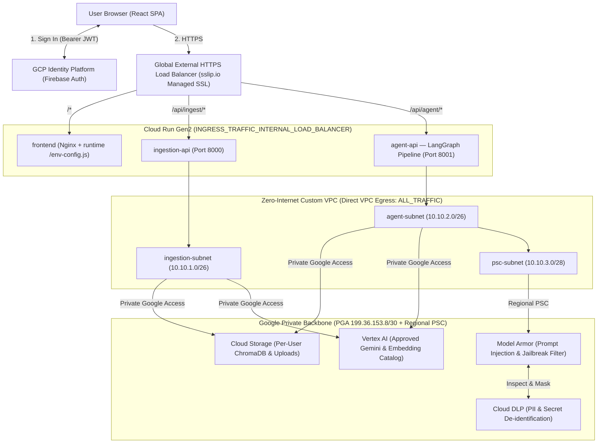

# InteractiveRAG

**InteractiveRAG** is a production-hardened, multi-tenant **Agentic Retrieval-Augmented Generation (RAG)** platform built with **LangGraph**, **Google Cloud Vertex AI** (`gemini-3.8-flash` & `gemini-embedding-001`), **ChromaDB**, **FastAPI**, and **React**.

Instead of pooling unrelated files into a single shared index, InteractiveRAG lets each user organize PDFs into isolated, domain-specific Chroma vector collections (for example, separating annual financial filings from market research). Through the React dashboard or REST APIs:
- **Ingestion & Collection Management (`POST /ingest`, `GET /collections`, `DELETE /collections/{name}`)**: Validates uploaded PDFs, splits pages into overlapping text chunks, computes dense embeddings with `gemini-embedding-001`, and indexes them into the target collection.
- **Direct Semantic Search (`POST /query`)**: Runs top-$k$ similarity search scoped strictly to a chosen collection to inspect raw passages and metadata.
- **Agentic RAG Assistant (`POST /agent`, `POST /agent/stream`)**: Dynamically binds a collection-scoped retriever tool to a hardened LangGraph `StateGraph` agent (`gemini-3.8-flash`) that retrieves evidence, enforces inline `[source, p.X]` citations, screens prompts and responses through **Google Cloud Model Armor** and **Sensitive Data Protection (Cloud DLP)**, and streams reasoning steps in real time over Server-Sent Events (SSE).

---

## 🏗️ Cloud Architecture & Security Posture

InteractiveRAG is engineered for reproducible deployment on **Google Cloud Platform (GCP)** across three defense-in-depth layers documented in [`docs/`](docs/):



### 1. Multi-Tenant Cloud Deployment & Persistence ([`docs/GCP_DEPLOYMENT_PLAN.md`](docs/GCP_DEPLOYMENT_PLAN.md))

Multiple authenticated users share the cloud deployment safely—each tenant gets isolated storage and conversation state while serverless instances scale to zero when idle without losing persisted indexes.

- **Serverless Microservices (`Cloud Run Gen2` + `Terraform`)**
  - Deployed as three independent auto-scaling Cloud Run services—`frontend` (Nginx serving the React SPA), `ingestion-api` (PDF parsing, embedding, and collection management), and `agent-api` (stateful LangGraph agent and SSE streaming)—provisioned reproducibly with **Terraform** (`infra/`) and **Cloud Build** (`cloudbuild.yaml`).
- **Zero-Trust Identity & Tenant Isolation (`Identity Platform` / `Firebase Auth`)**
  - Users sign in via **Google OAuth** or **Email/Password** (`frontend/src/AuthGate.jsx`), and `authFetch` (`frontend/src/App.jsx`) attaches `Authorization: Bearer <ID_TOKEN>` to every REST and SSE call (automatically refreshing expired tokens on `401`).
  - On the backend, `get_current_user` (`src/core/auth.py`) cryptographically verifies the JWT and extracts the immutable `uid`. Storage paths (`/tmp/chroma_db/{uid}`, `gs://<bucket>/users/{uid}/`) and LangGraph checkpoint threads (`{uid}:{thread_id}`) are derived strictly server-side from that verified `uid`—never from client request payloads—so different users can create collections with identical names without collision or cross-tenant visibility.
  - When running on Cloud Run, server-filesystem `pdf_paths` ingestion is disabled so callers can only upload their own multipart PDF files.
- **Per-User GCS ↔ `/tmp` ChromaDB Synchronization (`src/core/storage.py`)**
  - **Why not mount Cloud Storage directly?** ChromaDB uses SQLite (`chroma.sqlite3`) and memory-mapped HNSW index segments, whereas Cloud Storage lacks POSIX byte-range file locking—sharing a direct FUSE mount across `ingestion-api` and `agent-api` risks SQLite lock failures and corruption, while Cloud Run's local `/tmp` memory is wiped whenever instances scale to zero.
  - **Coherent Sync & Distributed Locking:** Each user's authoritative ChromaDB snapshot is persisted under `gs://<bucket>/users/{uid}/chroma_db/` with a `version.json` marker:
    - **Read path (`/query`, `/agent`, `/collections`):** Checks remote `version.json` against `/tmp/chroma_db/{uid}/version.json`, downloading updated blobs into fast in-memory `tmpfs` only when stale and evicting inactive tenant caches via LRU when `/tmp` space is low.
    - **Write path (`/ingest`, `DELETE /collections`):** Acquires an atomic GCS lock (`users/{uid}/locks/chroma.lock` via `if_generation_match=0` with stale-lock TTL recovery), syncs the latest snapshot, performs ChromaDB writes locally, uploads modified segments + increments `version.json`, and releases the lock so `agent-api` immediately sees newly ingested documents.
- **Startup Runtime Frontend Configuration (`/env-config.js`)**
  - Standard Vite builds bake `VITE_*` variables into static JavaScript during `docker build`, creating a chicken-and-egg dependency because images are built *before* Terraform provisions the Load Balancer URL and Identity Platform web API key.
  - Instead, `docker/entrypoint-frontend.sh` reads Cloud Run environment variables injected by Terraform (`infra/cloud_run.tf`) at container startup (`INGESTION_API_URL="/api/ingest"`, `AGENT_API_URL="/api/agent"`, `FIREBASE_API_KEY`, etc.) and writes `/usr/share/nginx/html/env-config.js` (`window.__ENV__`), allowing one immutable frontend image to run across any environment without rebuilding.

### 2. Zero-Internet VPC & Network Security ([`docs/NETWORK_SECURITY_PLAN.md`](docs/NETWORK_SECURITY_PLAN.md))

External traffic enters exclusively through a single managed HTTPS Load Balancer, while backend containers run inside a segmented private VPC with zero outbound access to the public internet.

- **Single HTTPS Entry Point (`Global External Application Load Balancer` — `infra/load_balancer.tf`)**
  - **TLS Termination & Managed `sslip.io` Certificate:** Reserves a global static Anycast IP and derives `<IP-with-dashes>.sslip.io` (a wildcard DNS hostname resolving back to that IP so Certificate Authorities and Firebase Auth have a valid domain without buying one). Google Cloud automatically provisions and renews a free trusted TLS certificate (`lb_cert`), decrypts incoming `https://` traffic at the Load Balancer (`https_proxy`), and redirects plain port-80 `http://` requests to `https://` with HTTP `301`.
  - **Single-Origin Path Routing & Serverless NEGs:** Once `frontend` serves the React bundle, UI actions execute in the user's browser over the internet. The Load Balancer's URL map (`https_router`) exposes the UI and APIs on one HTTPS origin—routing `/*` to `frontend`, rewriting `/api/ingest/*` $\rightarrow$ `/*` for `ingestion-api`, and rewriting `/api/agent/*` $\rightarrow$ `/*` for `agent-api`—connecting to dynamic Cloud Run containers via **Serverless Network Endpoint Groups (NEGs)** with edge CDN disabled (`enable_cdn = false`) so authenticated responses and SSE streams are never cached.
- **Locked Cloud Run Ingress (`infra/cloud_run.tf`)**
  - All three Cloud Run services set `ingress = "INGRESS_TRAFFIC_INTERNAL_LOAD_BALANCER"`, blocking direct internet requests to raw `*.run.app` service URLs at Google's edge while accepting requests forwarded by the Load Balancer.
- **Segmented Zero-Internet VPC (`Direct VPC Egress` — `infra/network.tf`)**
  - `ingestion-api` (`10.10.1.0/26`, which parses untrusted PDFs) and `agent-api` (`10.10.2.0/26`) route all outbound traffic (`ALL_TRAFFIC`) via **Cloud Run Direct VPC Egress** into separate subnets inside a custom VPC configured with `delete_default_routes_on_create = true`. Removing the `0.0.0.0/0` default internet route drops packets to any external internet IP, preventing outbound data exfiltration.
- **Private Google API Connectivity (`Private Google Access` vs. `Regional PSC` — `infra/network.tf`)**
  - **Standard `*.googleapis.com` APIs (`Cloud Storage`, `Vertex AI`, `Identity Platform`):** Requires two paired layers inside the zero-internet VPC:
    1. *Private Cloud DNS (`googleapis.com.`)* overrides `*.googleapis.com` lookups to return Google's 4 Private Google Access Virtual IPs (`199.36.153.8`–`.11`) instead of unroutable public Google IPs (Google Front End load balancers route to the right service using the TLS SNI / HTTP `Host` header).
    2. *Explicit VPC Route (`199.36.153.8/30`)* permits packets only to that `/30` VIP range onto Google's internal backbone while leaving all other external IPs unreachable.
  - **Regional Model Armor API (`modelarmor.<region>.rep.googleapis.com`):** Because Google's `199.36.153.8/30` VIPs do not support regional `*.rep.googleapis.com` endpoints, Terraform pairs:
    1. *Regional Private Service Connect (`modelarmor_psc`)* to allocate a dedicated internal IP (`10.10.3.2` in `psc-subnet`) wired directly to the regional Model Armor backend (routable locally within the VPC without an extra `google_compute_route`).
    2. *Specific Private DNS Zone (`modelarmor.<region>.rep.googleapis.com.`)* that overrides the broader `*.googleapis.com.` wildcard via longest-suffix matching and resolves the regional hostname to `10.10.3.2` while keeping TLS hostname verification valid.

### 3. AI-Specific Security — 5 Pillars ([`docs/AI_SECURITY_PLAN.md`](docs/AI_SECURITY_PLAN.md))

Every query and retrieved document passage flows through a hardened LangGraph pipeline (`START -> input_guard -> model_call <-> tools -> output_guard -> END`) enforcing five defense-in-depth pillars:

1. **Prompt Injection Mitigation (Pre-LLM Screening + XML Data Isolation)**
   - **Managed Front-Door Screening (`input_guard`):** Before invoking Gemini, `screen_user_prompt()` (`src/core/security.py`) calls **Google Cloud Model Armor** (`sanitizeUserPrompt`) over Regional PSC to detect prompt-injection, jailbreak, and malicious-URI payloads—short-circuiting blocked prompts directly to `END` without consuming LLM tokens.
   - **XML Spotlighting & Tag Escaping (`src/agent/tools.py`):** Retrieved PDF passages are enclosed in `<retrieved_chunk source="report.pdf" page="1">...</retrieved_chunk>` with embedded `<` and `>` characters escaped (`&lt;` / `&gt;`) so a malicious PDF cannot forge a closing `</retrieved_chunk>` tag to break out of the data boundary.
   - **Instruction Hierarchy & Identifier Validation:** `SYSTEM_PROMPT` (`src/agent/graph.py`) instructs Gemini to treat all `<retrieved_chunk>` content and user messages strictly as untrusted data, while `validate_collection_name()` enforces `^[a-zA-Z0-9_-]{1,64}$` across all endpoints so instructions cannot be smuggled into tool descriptions via collection names.
2. **Model Access Controls (Server-Enforced Multi-Option Catalogs)**
   - Instead of allowing callers to pass arbitrary Vertex AI model IDs, `src/core/config.py` defines curated server allowlists (`ALLOWED_LLM_MODELS`: `gemini-3.8-flash`, `gemini-2.5-flash`, `gemini-2.5-pro`; `ALLOWED_EMBEDDING_MODELS`: `gemini-embedding-001`, `text-embedding-005`).
   - Pydantic request schemas and multipart upload parsers across `/ingest`, `/query`, and `/agent` apply safe defaults when omitted and reject unapproved models immediately with HTTP `422`.
3. **AI & Ingestion Guardrails (Grounding, Citations, Upload & Loop Ceilings)**
   - **Strict Grounding & Mandatory `[source, p.X]` Citations:** The retriever converts PyPDF's 0-indexed page metadata into 1-indexed `page` attributes, and the system prompt requires every factual statement to rely exclusively on retrieved chunks with inline `[filename.pdf, p.X]` citations—or explicitly abstain when evidence is missing.
   - **Input, Upload & Loop Ceilings:** Enforces `MAX_QUERY_CHARS` (`4000`), `%PDF-` magic-byte signature checks (rejecting disguised non-PDF files with `400`), `MAX_UPLOAD_MB` (`20` MB per PDF, returning `413`), `MAX_FILES_PER_REQUEST` (`10`), `MAX_CHUNKS_PER_INGEST` (`1000`), and a LangGraph `recursion_limit` (`AGENT_RECURSION_LIMIT=6` in `src/agent/stream.py`) that cleanly halts runaway tool-calling loops.
4. **Output Filtering & Sanitized Errors (Cloud DLP + Model Armor Across JSON & SSE)**
   - **Managed PII & Secret Masking (`output_guard`):** Provisioned in `infra/ai_security.tf`, a **Cloud DLP Inspect + De-identify Template** integrated into Model Armor (`sanitizeModelResponse`) automatically masks `EMAIL_ADDRESS`, `PHONE_NUMBER`, `CREDIT_CARD_NUMBER`, `US_SOCIAL_SECURITY_NUMBER`, `IBAN_CODE`, `GCP_API_KEY`, and `AUTH_TOKEN` matches with `[INFO_TYPE]` placeholders.
   - **Unified REST & Live SSE Redaction:** `model_call` holds candidate final answers in `pending_response` so `output_guard` sanitizes the message *before* committing it to `messages` or yielding SSE frames in `stream_sse`—ensuring unredacted PII never leaks in either `stream=false` JSON or `stream=true` SSE mode.
   - **Sanitized `500` Responses:** Unexpected exceptions across FastAPI endpoints and SSE generators log full tracebacks privately on the server while returning a safe `"An internal server error occurred. Please try again later."` message to clients.
5. **Content Safety (Pinned Harm Thresholds & Polite Refusal Fallbacks)**
   - Configures `ChatGoogleGenerativeAI` explicitly across `HATE_SPEECH`, `HARASSMENT`, `SEXUALLY_EXPLICIT`, and `DANGEROUS_CONTENT` using `GEMINI_SAFETY_THRESHOLD` (default `BLOCK_LOW_AND_ABOVE`), alongside Model Armor's RAI filters.
   - Checks `is_safety_blocked(response)` on model outputs (`finish_reason` in `SAFETY`, `PROHIBITED_CONTENT`, `SPII`, `BLOCKLIST`) and substitutes a clear, polite refusal fallback instead of returning a blank answer.

---

## 📁 Directory Structure & Components

```text
InteractiveRAG/
├── src/                            # Unified Python backend packages
│   ├── core/                       # Auth, config, AI security, GCS storage, Chroma & shared routes
│   │   ├── auth.py                 # Firebase Bearer JWT verification & CORS setup
│   │   ├── chroma.py               # Vertex AI embeddings & ChromaDB client helpers
│   │   ├── config.py               # Model catalogs, guardrail ceilings & environment defaults
│   │   ├── logger.py               # Structured logging configuration
│   │   ├── routes.py               # Shared FastAPI factory (/health, /collections)
│   │   ├── security.py             # Validators, Gemini safety settings & Model Armor / DLP client
│   │   └── storage.py              # Per-user GCS <-> /tmp Chroma sync, LRU eviction & write locks
│   ├── ingestion/                  # Document Ingestion & Vector Search API (Port 8000)
│   │   ├── app.py                  # FastAPI endpoints (/ingest, /query, /collections, /health)
│   │   ├── loader.py               # PDF magic-byte/size/chunk guardrails & text splitting
│   │   ├── schemas.py              # Validated IngestRequest & QueryRequest models
│   │   └── service.py              # Batched ChromaDB indexing & top-k similarity search
│   ├── agent/                      # LangGraph Agentic RAG & SSE Streaming API (Port 8001)
│   │   ├── app.py                  # FastAPI endpoints (/agent, /agent/stream, /collections, /health)
│   │   ├── display.py              # Rich terminal message formatting
│   │   ├── graph.py                # LangGraph StateGraph (input_guard -> model_call <-> tools -> output_guard)
│   │   ├── schemas.py              # Validated AgentRequest & AgentState definitions
│   │   ├── stream.py               # Bounded recursion runner & deduplicated SSE streaming
│   │   └── tools.py                # XML-spotlighted retriever tool with 1-indexed page metadata
│   └── README.md                   # Detailed module-level backend documentation
├── frontend/                       # React + Vite web dashboard (Port 3000)
│   └── src/                        # App.jsx, AuthGate.jsx (Firebase Sign-In), firebase.js, index.css
├── infra/                          # Reproducible Terraform IaC for GCP
│   ├── ai_security.tf              # Cloud DLP inspect/de-identify templates & Model Armor template
│   ├── apis.tf                     # Project API enablement & Artifact Registry
│   ├── auth.tf                     # Identity Platform (Email/Password + Google OAuth) & web API key
│   ├── cloud_run.tf                # Locked-down frontend, ingestion-api & agent-api services
│   ├── cloudbuild-terraform.yaml   # Remote Terraform execution pipeline for Cloud Build
│   ├── iam.tf                      # Backend service account & least-privilege IAM bindings
│   ├── load_balancer.tf            # Global External HTTPS Load Balancer, NEGs & sslip.io cert
│   ├── network.tf                  # Zero-internet VPC, subnets, Private Google Access & Regional PSC
│   ├── outputs.tf                  # Load Balancer URL/IP, Cloud Run URLs & security template IDs
│   ├── storage.tf                  # Private versioned GCS persistence bucket
│   ├── terraform.tfvars.example    # Example Terraform variable configuration
│   ├── variables.tf                # Configurable infra, network & AI security variables
│   └── versions.tf                 # Terraform & Google provider constraints + GCS backend
├── docker/                         # Container build & runtime configs (backend, frontend, Nginx)
├── docs/                           # Architecture & security blueprints
│   ├── GCP_DEPLOYMENT_PLAN.md      # Multi-tenant Cloud Run, Identity Platform & GCS sync plan
│   ├── NETWORK_SECURITY_PLAN.md    # Zero-internet VPC, HTTPS Load Balancer & Private Endpoints plan
│   └── AI_SECURITY_PLAN.md         # 5-pillar AI security plan (Model Armor, Cloud DLP & guardrails)
├── tests/                          # Offline unit suites & live endpoint smoke scripts
│   ├── auth.py                     # JWT verification, tenant UID validation & local bypass tests
│   ├── storage.py                  # Per-user GCS sync, distributed lock & LRU cache unit tests
│   ├── multi_tenant_api.py         # End-to-end multi-tenant isolation tests across APIs
│   ├── ai_security.py              # Comprehensive unit tests for all 5 AI security pillars
│   ├── ingestion.py                # Live local ingestion & similarity search smoke script
│   └── agent.py                    # Live local JSON & SSE agent smoke script
├── data/                           # Sample PDF documents for local testing
├── Makefile                        # One-command GCP bootstrap, image build, plan, deploy & destroy
├── cloudbuild.yaml                 # Multi-image Cloud Build pipeline (backend + frontend)
└── requirements.txt                # Python dependencies
```

---

## 🚀 Local Setup & Prerequisites

### 1. Google Cloud Credentials & `.env`
Authenticate Application Default Credentials (ADC) for Vertex AI:
```bash
gcloud auth application-default login
```

Create a `.env` file in the project root:
```bash
GOOGLE_CLOUD_PROJECT="interactive-rag"
GOOGLE_CLOUD_LOCATION="global"

# Local development only (ignored automatically in Cloud Run when K_SERVICE is set):
AUTH_DISABLED="true"
DEV_USER_ID="local-dev"

# Optional AI security overrides (defaults shown):
# ALLOWED_LLM_MODELS="gemini-3.8-flash,gemini-2.5-flash,gemini-2.5-pro"
# ALLOWED_EMBEDDING_MODELS="gemini-embedding-001,text-embedding-005"
# GEMINI_SAFETY_THRESHOLD="BLOCK_LOW_AND_ABOVE"
# MODEL_ARMOR_TEMPLATE_ID=""  # Set full template resource name to enable live Model Armor locally
```

### 2. Python Environment
```bash
python3 -m venv .venv
source .venv/bin/activate
pip install -r requirements.txt
```

### 3. Frontend Dependencies
```bash
cd frontend
npm install
cd ..
```

---

## 🏃 Running Locally

Start each service in a separate terminal from the project root:

1. **Document Ingestion API (Port 8000)**
   ```bash
   python -m src.ingestion
   ```
2. **Agentic RAG API (Port 8001)**
   ```bash
   python -m src.agent
   ```
3. **React Frontend Dashboard (Port 3000)**
   ```bash
   cd frontend && npm run dev
   ```

Open **http://localhost:3000** in your browser.

---

## ☁️ Deploying to Google Cloud (Terraform + Cloud Build)

The root [`Makefile`](Makefile) automates end-to-end provisioning. It auto-detects whether `terraform` is installed locally (`TF_MODE=local`) or executes Terraform remotely via Google Cloud Build (`TF_MODE=cloudbuild`) using a dedicated least-privilege deployer service account.

1. **Configure Terraform Variables**
   ```bash
   cp infra/terraform.tfvars.example infra/terraform.tfvars
   # Edit infra/terraform.tfvars with your project_id, region, and optional security/OAuth settings
   ```

2. **Bootstrap APIs, State Bucket & Artifact Registry**
   ```bash
   make bootstrap PROJECT_ID=interactive-rag
   ```

3. **Build & Push Container Images (`linux/amd64`)**
   ```bash
   make build-push PROJECT_ID=interactive-rag
   ```

4. **Preview & Apply Full Infrastructure Stack**
   ```bash
   make plan PROJECT_ID=interactive-rag
   make deploy PROJECT_ID=interactive-rag
   ```

5. **Inspect Live Load Balancer URL & Provisioned Outputs**
   ```bash
   make outputs PROJECT_ID=interactive-rag
   ```
   > **Note:** On initial deployment, allow ~10–15 minutes for the Google-managed SSL certificate on `https://<LB-IP-with-dashes>.sslip.io` to reach `ACTIVE` status. If Google Sign-In OAuth is enabled, add the `sslip.io` URL to your OAuth 2.0 Web Client's **Authorized JavaScript origins** in the GCP Console.

---

## 🧪 Testing & Verification

### 1. Offline Unit, Multi-Tenant & AI Security Test Suite
Runs all mocked unit tests covering Firebase JWT auth, GCS distributed locks/sync, strict cross-tenant isolation, model allowlists, upload guardrails, XML spotlighting, Model Armor prompt blocking, Cloud DLP output redaction, recursion caps, safety refusals, and sanitized `500` responses:
```bash
python -m unittest tests.auth tests.storage tests.multi_tenant_api tests.ai_security -v
```

### 2. Live Local Smoke Scripts
With `src.ingestion` (port `8000`) and `src.agent` (port `8001`) running locally:
```bash
# Ingest sample PDFs into ChromaDB and verify similarity search
python -m tests.ingestion

# Exercise Agentic RAG in both standard JSON and live SSE streaming modes
python -m tests.agent
```

### 3. Manual API Testing via `curl`
For local requests with `AUTH_DISABLED=true`, use `http://localhost:8000` and `http://localhost:8001`. Against the deployed Load Balancer (`https://<LB-HOST>`), prefix paths with `/api/ingest` or `/api/agent` and include `-H "Authorization: Bearer <ID_TOKEN>"`:

```bash
# 1. Upload & index a PDF (multipart upload works both locally and on Cloud Run)
curl -X POST "http://localhost:8000/ingest" \
  -F "files=@./data/Stock_Market_Performance_2024.pdf" \
  -F "collection_name=stock_market_vs" \
  -F "embedding_model=gemini-embedding-001"

# 2. Direct top-k semantic similarity search
curl -X POST "http://localhost:8000/query" \
  -H "Content-Type: application/json" \
  -d '{
    "query": "What is ARM Holdings?",
    "collection_name": "stock_market_vs",
    "k": 3
  }'

# 3. Grounded Agentic RAG query (returns inline [source, p.X] citations; set "stream": true for SSE)
curl -X POST "http://localhost:8001/agent" \
  -H "Content-Type: application/json" \
  -d '{
    "query": "What was ARM Holdings financial performance in 2024?",
    "collection_name": "stock_market_vs",
    "model_name": "gemini-3.8-flash",
    "stream": false
  }'
```

### 4. Interactive Dashboard Workflow
1. Open **http://localhost:3000** (or your deployed `https://<LB-IP-with-dashes>.sslip.io` URL and sign in via **Identity Platform**).
2. **Ingest PDFs**: Upload one or more PDF files into a named collection using an approved embedding model.
3. **Inspect Collections**: View your tenant-isolated collections and indexed chunk counts, or delete obsolete collections.
4. **Chat & Verify Grounding**: Select an approved Gemini model and ask questions in the chat panel to watch real-time retriever tool calls, grounded `[filename.pdf, p.X]` citations, and DLP-filtered responses.
