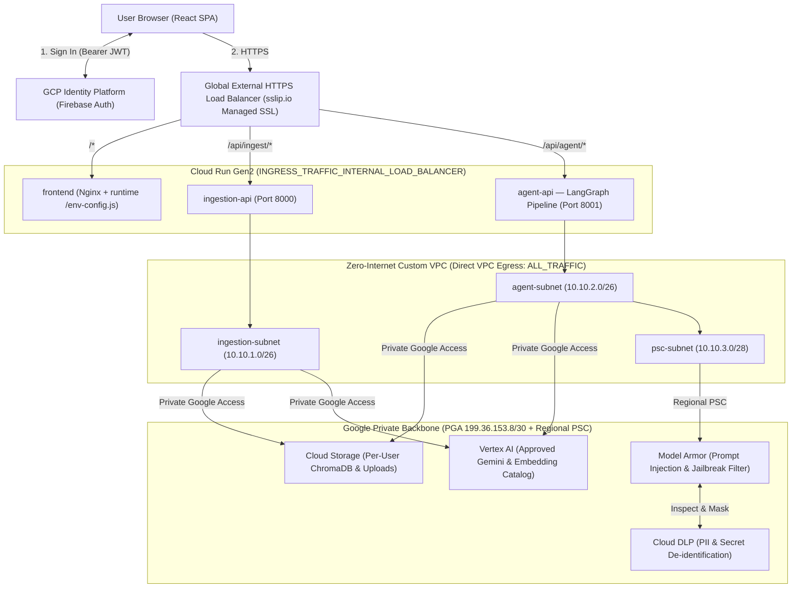

# InteractiveRAG

**InteractiveRAG** is a production-hardened, multi-tenant **Agentic Retrieval-Augmented Generation (RAG)** platform built with **LangGraph**, **Google Cloud Vertex AI** (`gemini-3.8-flash` & `gemini-embedding-001`), **ChromaDB**, **FastAPI**, and **React**.

Instead of pooling unrelated files into a single shared index, InteractiveRAG lets each user organize PDFs into isolated, domain-specific Chroma vector collections (for example, separating annual financial filings from market research). Through the React dashboard or REST APIs:
- **Ingestion & Collection Management (`POST /ingest`, `GET /collections`, `DELETE /collections/{name}`)**: Validates uploaded PDFs, splits pages into overlapping text chunks, computes dense embeddings with `gemini-embedding-001`, and indexes them into the target collection.
- **Direct Semantic Search (`POST /query`)**: Runs top-$k$ similarity search scoped strictly to a chosen collection to inspect raw passages and metadata.
- **Agentic RAG Assistant (`POST /agent`, `POST /agent/stream`)**: Dynamically binds a collection-scoped retriever tool to a hardened LangGraph `StateGraph` agent (`gemini-3.8-flash`) that retrieves evidence, enforces inline `[source, p.X]` citations, screens prompts and responses through **Google Cloud Model Armor** and **Sensitive Data Protection (Cloud DLP)**, and streams reasoning steps in real time over Server-Sent Events (SSE).

---

## 🏗️ Cloud Architecture & Security Posture

InteractiveRAG is engineered for reproducible deployment on **Google Cloud Platform (GCP)** across three defense-in-depth layers documented in [`docs/`](docs/):



### 1. Multi-Tenant Cloud Deployment & Persistence ([`docs/GCP_DEPLOYMENT_PLAN.md`](docs/GCP_DEPLOYMENT_PLAN.md))

Multiple authenticated users share the cloud deployment safely—each tenant gets isolated storage and conversation state while serverless instances scale to zero when idle.

- **Serverless Microservices (`Cloud Run` + `Terraform`)**
  - Three independent Cloud Run services—`frontend` (React SPA), `ingestion-api` (PDF indexing & search), and `agent-api` (LangGraph assistant)—provisioned reproducibly with **Terraform** (`infra/`) and **Cloud Build** (`cloudbuild.yaml`).
- **Identity & Multi-Tenant Isolation (`Identity Platform`)**
  - Authenticates users via **Google OAuth** or **Email/Password** using **Google Cloud Identity Platform** (Firebase Auth).
  - Backend endpoints verify Bearer ID tokens (`src/core/auth.py`) and scope all storage paths and conversation threads to the verified `uid`, preventing cross-tenant access even when collection names match.
- **Persistent Vector Storage Sync (`Cloud Storage` ↔ `ChromaDB`)**
  - Persists each user's PDFs and ChromaDB indexes under `gs://<bucket>/users/{uid}/` in **Google Cloud Storage**, syncing active indexes to local `/tmp` memory with distributed write locks (`src/core/storage.py`) so data survives scale-to-zero events safely.
- **Runtime Frontend Configuration (`/env-config.js`)**
  - Container startup injects live API endpoints and Firebase credentials into `/env-config.js` (`docker/entrypoint-frontend.sh`), allowing a single frontend image to deploy across environments without rebuilding.

### 2. Zero-Internet VPC & Network Security ([`docs/NETWORK_SECURITY_PLAN.md`](docs/NETWORK_SECURITY_PLAN.md))

External traffic enters exclusively through a single managed HTTPS Load Balancer, while backend services run inside an isolated VPC with no public internet access.

- **Single HTTPS Entry Point (`Global External Application Load Balancer`)**
  - Encrypts browser traffic over `https://` and decrypts incoming requests at the Load Balancer (`TLS termination`) using a free, auto-renewed Google-managed TLS certificate issued for the Load Balancer's `<IP>.sslip.io` domain, while automatically redirecting plain `http://` requests to `https://` (`infra/load_balancer.tf`).
  - Because the React UI runs in the user's browser after initial page load, the Load Balancer routes browser requests on a single domain by URL path—`/*` to `frontend`, `/api/ingest/*` to `ingestion-api`, and `/api/agent/*` to `agent-api`—connecting to dynamic Cloud Run containers via **Serverless Network Endpoint Groups (NEGs)**.
- **Locked Cloud Run Ingress**
  - Direct public access to all three `*.run.app` URLs is disabled—Cloud Run only accepts traffic forwarded by the Load Balancer (`infra/cloud_run.tf`).
- **Segmented Zero-Internet VPC (`Direct VPC Egress`)**
  - `ingestion-api` and `agent-api` run in separate subnets inside a custom VPC with the default internet route removed, blocking all outbound public internet traffic (`infra/network.tf`).
- **Private Google API Connectivity (`Private Google Access`, `PSC` & `Cloud DNS`)**
  - **Standard Google APIs (`Cloud Storage`, `Vertex AI`, `Identity Platform`)**: Private Cloud DNS and an explicit VPC route keep `*.googleapis.com` calls strictly on Google's internal network via **Private Google Access**.
  - **Regional Model Armor API**: Because Private Google Access does not cover regional `*.rep.googleapis.com` endpoints, a **Regional Private Service Connect (PSC)** endpoint and private DNS zone route Model Armor calls to an internal VPC IP.

### 3. AI-Specific Security — 5 Pillars ([`docs/AI_SECURITY_PLAN.md`](docs/AI_SECURITY_PLAN.md))
1. **Prompt Injection Mitigation**: Pre-LLM screening in LangGraph's `input_guard` node via **Google Cloud Model Armor** (`sanitizeUserPrompt`), XML spotlighting (`<retrieved_chunk source="..." page="...">`) with `<`/`>` tag-breakout escaping (`src/agent/tools.py`), hardened `SystemMessage` instruction hierarchy (`src/agent/graph.py`), and strict `^[a-zA-Z0-9_-]{1,64}$` collection-name validation.
2. **Model Access Controls**: Server-enforced multi-option catalogs (`ALLOWED_LLM_MODELS` & `ALLOWED_EMBEDDING_MODELS`) validated across `/ingest`, `/query`, and `/agent`, rejecting unapproved models with HTTP `422`.
3. **AI & Ingestion Guardrails**: Mandatory 1-indexed `[source, p.X]` inline citations and explicit abstention when evidence is absent; `MAX_QUERY_CHARS`, `%PDF-` magic-byte checks, `MAX_UPLOAD_MB` (`413`), `MAX_FILES_PER_REQUEST`, `MAX_CHUNKS_PER_INGEST`, and bounded LangGraph tool loops (`AGENT_RECURSION_LIMIT=6`).
4. **Output Filtering & Safe Errors**: Post-LLM `output_guard` masks sensitive PII and credentials (`[EMAIL_ADDRESS]`, `[PHONE_NUMBER]`, `[CREDIT_CARD_NUMBER]`, `[US_SOCIAL_SECURITY_NUMBER]`, `[IBAN_CODE]`, `[GCP_API_KEY]`, `[AUTH_TOKEN]`) via **Model Armor + Cloud DLP** (`sanitizeModelResponse`) across both JSON and live SSE responses, while unexpected server exceptions return sanitized HTTP `500` messages.
5. **Content Safety**: Explicit, configurable Gemini `safety_settings` (`GEMINI_SAFETY_THRESHOLD`, default `BLOCK_LOW_AND_ABOVE`) across all harm categories paired with clear, polite refusal fallbacks (`is_safety_blocked`) instead of blank responses.

---

## 📁 Directory Structure & Components

```text
InteractiveRAG/
├── src/                            # Unified Python backend packages
│   ├── core/                       # Auth, config, AI security, GCS storage, Chroma & shared routes
│   │   ├── auth.py                 # Firebase Bearer JWT verification & CORS setup
│   │   ├── chroma.py               # Vertex AI embeddings & ChromaDB client helpers
│   │   ├── config.py               # Model catalogs, guardrail ceilings & environment defaults
│   │   ├── logger.py               # Structured logging configuration
│   │   ├── routes.py               # Shared FastAPI factory (/health, /collections)
│   │   ├── security.py             # Validators, Gemini safety settings & Model Armor / DLP client
│   │   └── storage.py              # Per-user GCS <-> /tmp Chroma sync, LRU eviction & write locks
│   ├── ingestion/                  # Document Ingestion & Vector Search API (Port 8000)
│   │   ├── app.py                  # FastAPI endpoints (/ingest, /query, /collections, /health)
│   │   ├── loader.py               # PDF magic-byte/size/chunk guardrails & text splitting
│   │   ├── schemas.py              # Validated IngestRequest & QueryRequest models
│   │   └── service.py              # Batched ChromaDB indexing & top-k similarity search
│   ├── agent/                      # LangGraph Agentic RAG & SSE Streaming API (Port 8001)
│   │   ├── app.py                  # FastAPI endpoints (/agent, /agent/stream, /collections, /health)
│   │   ├── display.py              # Rich terminal message formatting
│   │   ├── graph.py                # LangGraph StateGraph (input_guard -> model_call <-> tools -> output_guard)
│   │   ├── schemas.py              # Validated AgentRequest & AgentState definitions
│   │   ├── stream.py               # Bounded recursion runner & deduplicated SSE streaming
│   │   └── tools.py                # XML-spotlighted retriever tool with 1-indexed page metadata
│   └── README.md                   # Detailed module-level backend documentation
├── frontend/                       # React + Vite web dashboard (Port 3000)
│   └── src/                        # App.jsx, AuthGate.jsx (Firebase Sign-In), firebase.js, index.css
├── infra/                          # Reproducible Terraform IaC for GCP
│   ├── ai_security.tf              # Cloud DLP inspect/de-identify templates & Model Armor template
│   ├── apis.tf                     # Project API enablement & Artifact Registry
│   ├── auth.tf                     # Identity Platform (Email/Password + Google OAuth) & web API key
│   ├── cloud_run.tf                # Locked-down frontend, ingestion-api & agent-api services
│   ├── cloudbuild-terraform.yaml   # Remote Terraform execution pipeline for Cloud Build
│   ├── iam.tf                      # Backend service account & least-privilege IAM bindings
│   ├── load_balancer.tf            # Global External HTTPS Load Balancer, NEGs & sslip.io cert
│   ├── network.tf                  # Zero-internet VPC, subnets, Private Google Access & Regional PSC
│   ├── outputs.tf                  # Load Balancer URL/IP, Cloud Run URLs & security template IDs
│   ├── storage.tf                  # Private versioned GCS persistence bucket
│   ├── terraform.tfvars.example    # Example Terraform variable configuration
│   ├── variables.tf                # Configurable infra, network & AI security variables
│   └── versions.tf                 # Terraform & Google provider constraints + GCS backend
├── docker/                         # Container build & runtime configs (backend, frontend, Nginx)
├── docs/                           # Architecture & security blueprints
│   ├── GCP_DEPLOYMENT_PLAN.md      # Multi-tenant Cloud Run, Identity Platform & GCS sync plan
│   ├── NETWORK_SECURITY_PLAN.md    # Zero-internet VPC, HTTPS Load Balancer & Private Endpoints plan
│   └── AI_SECURITY_PLAN.md         # 5-pillar AI security plan (Model Armor, Cloud DLP & guardrails)
├── tests/                          # Offline unit suites & live endpoint smoke scripts
│   ├── auth.py                     # JWT verification, tenant UID validation & local bypass tests
│   ├── storage.py                  # Per-user GCS sync, distributed lock & LRU cache unit tests
│   ├── multi_tenant_api.py         # End-to-end multi-tenant isolation tests across APIs
│   ├── ai_security.py              # Comprehensive unit tests for all 5 AI security pillars
│   ├── ingestion.py                # Live local ingestion & similarity search smoke script
│   └── agent.py                    # Live local JSON & SSE agent smoke script
├── data/                           # Sample PDF documents for local testing
├── Makefile                        # One-command GCP bootstrap, image build, plan, deploy & destroy
├── cloudbuild.yaml                 # Multi-image Cloud Build pipeline (backend + frontend)
└── requirements.txt                # Python dependencies
```

---

## 🚀 Local Setup & Prerequisites

### 1. Google Cloud Credentials & `.env`
Authenticate Application Default Credentials (ADC) for Vertex AI:
```bash
gcloud auth application-default login
```

Create a `.env` file in the project root:
```bash
GOOGLE_CLOUD_PROJECT="interactive-rag"
GOOGLE_CLOUD_LOCATION="global"

# Local development only (ignored automatically in Cloud Run when K_SERVICE is set):
AUTH_DISABLED="true"
DEV_USER_ID="local-dev"

# Optional AI security overrides (defaults shown):
# ALLOWED_LLM_MODELS="gemini-3.8-flash,gemini-2.5-flash,gemini-2.5-pro"
# ALLOWED_EMBEDDING_MODELS="gemini-embedding-001,text-embedding-005"
# GEMINI_SAFETY_THRESHOLD="BLOCK_LOW_AND_ABOVE"
# MODEL_ARMOR_TEMPLATE_ID=""  # Set full template resource name to enable live Model Armor locally
```

### 2. Python Environment
```bash
python3 -m venv .venv
source .venv/bin/activate
pip install -r requirements.txt
```

### 3. Frontend Dependencies
```bash
cd frontend
npm install
cd ..
```

---

## 🏃 Running Locally

Start each service in a separate terminal from the project root:

1. **Document Ingestion API (Port 8000)**
   ```bash
   python -m src.ingestion
   ```
2. **Agentic RAG API (Port 8001)**
   ```bash
   python -m src.agent
   ```
3. **React Frontend Dashboard (Port 3000)**
   ```bash
   cd frontend && npm run dev
   ```

Open **http://localhost:3000** in your browser.

---

## ☁️ Deploying to Google Cloud (Terraform + Cloud Build)

The root [`Makefile`](Makefile) automates end-to-end provisioning. It auto-detects whether `terraform` is installed locally (`TF_MODE=local`) or executes Terraform remotely via Google Cloud Build (`TF_MODE=cloudbuild`) using a dedicated least-privilege deployer service account.

1. **Configure Terraform Variables**
   ```bash
   cp infra/terraform.tfvars.example infra/terraform.tfvars
   # Edit infra/terraform.tfvars with your project_id, region, and optional security/OAuth settings
   ```

2. **Bootstrap APIs, State Bucket & Artifact Registry**
   ```bash
   make bootstrap PROJECT_ID=interactive-rag
   ```

3. **Build & Push Container Images (`linux/amd64`)**
   ```bash
   make build-push PROJECT_ID=interactive-rag
   ```

4. **Preview & Apply Full Infrastructure Stack**
   ```bash
   make plan PROJECT_ID=interactive-rag
   make deploy PROJECT_ID=interactive-rag
   ```

5. **Inspect Live Load Balancer URL & Provisioned Outputs**
   ```bash
   make outputs PROJECT_ID=interactive-rag
   ```
   > **Note:** On initial deployment, allow ~10–15 minutes for the Google-managed SSL certificate on `https://<LB-IP-with-dashes>.sslip.io` to reach `ACTIVE` status. If Google Sign-In OAuth is enabled, add the `sslip.io` URL to your OAuth 2.0 Web Client's **Authorized JavaScript origins** in the GCP Console.

---

## 🧪 Testing & Verification

### 1. Offline Unit, Multi-Tenant & AI Security Test Suite
Runs all mocked unit tests covering Firebase JWT auth, GCS distributed locks/sync, strict cross-tenant isolation, model allowlists, upload guardrails, XML spotlighting, Model Armor prompt blocking, Cloud DLP output redaction, recursion caps, safety refusals, and sanitized `500` responses:
```bash
python -m unittest tests.auth tests.storage tests.multi_tenant_api tests.ai_security -v
```

### 2. Live Local Smoke Scripts
With `src.ingestion` (port `8000`) and `src.agent` (port `8001`) running locally:
```bash
# Ingest sample PDFs into ChromaDB and verify similarity search
python -m tests.ingestion

# Exercise Agentic RAG in both standard JSON and live SSE streaming modes
python -m tests.agent
```

### 3. Manual API Testing via `curl`
For local requests with `AUTH_DISABLED=true`, use `http://localhost:8000` and `http://localhost:8001`. Against the deployed Load Balancer (`https://<LB-HOST>`), prefix paths with `/api/ingest` or `/api/agent` and include `-H "Authorization: Bearer <ID_TOKEN>"`:

```bash
# 1. Upload & index a PDF (multipart upload works both locally and on Cloud Run)
curl -X POST "http://localhost:8000/ingest" \
  -F "files=@./data/Stock_Market_Performance_2024.pdf" \
  -F "collection_name=stock_market_vs" \
  -F "embedding_model=gemini-embedding-001"

# 2. Direct top-k semantic similarity search
curl -X POST "http://localhost:8000/query" \
  -H "Content-Type: application/json" \
  -d '{
    "query": "What is ARM Holdings?",
    "collection_name": "stock_market_vs",
    "k": 3
  }'

# 3. Grounded Agentic RAG query (returns inline [source, p.X] citations; set "stream": true for SSE)
curl -X POST "http://localhost:8001/agent" \
  -H "Content-Type: application/json" \
  -d '{
    "query": "What was ARM Holdings financial performance in 2024?",
    "collection_name": "stock_market_vs",
    "model_name": "gemini-3.8-flash",
    "stream": false
  }'
```

### 4. Interactive Dashboard Workflow
1. Open **http://localhost:3000** (or your deployed `https://<LB-IP-with-dashes>.sslip.io` URL and sign in via **Identity Platform**).
2. **Ingest PDFs**: Upload one or more PDF files into a named collection using an approved embedding model.
3. **Inspect Collections**: View your tenant-isolated collections and indexed chunk counts, or delete obsolete collections.
4. **Chat & Verify Grounding**: Select an approved Gemini model and ask questions in the chat panel to watch real-time retriever tool calls, grounded `[filename.pdf, p.X]` citations, and DLP-filtered responses.
