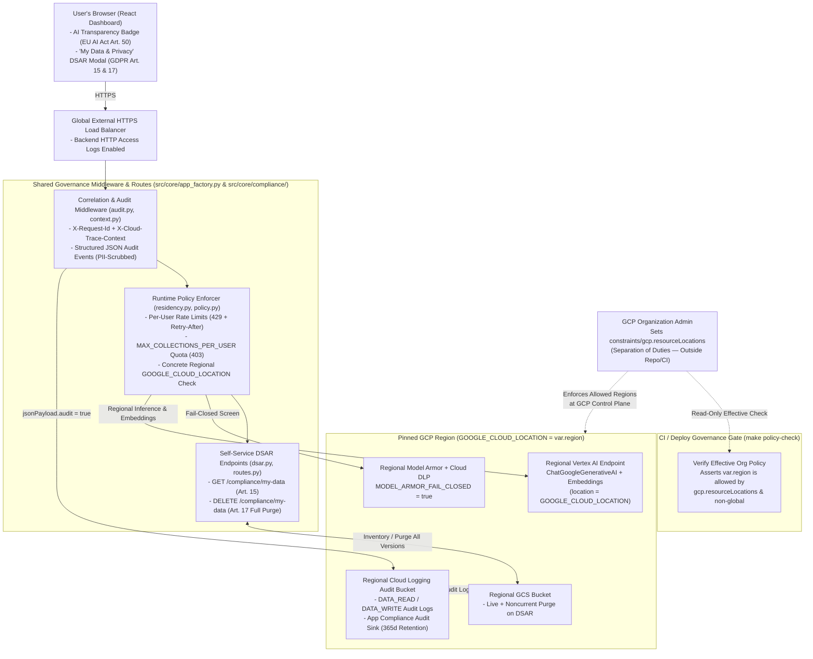

# Compliance & Governance Plan (Audit Logging, Data Residency, Regulatory Requirements & Policy Enforcement)

This document is the step-by-step blueprint for upgrading **InteractiveRAG** with a fourth defense-in-depth layer—**Compliance & Governance**—across four pillars:

1. **Data Residency** — Guarantee that uploaded PDFs, embeddings, and AI model calls never leave approved geographic regions. An Organization Policy Admin locks allowed regions on project `interactive-rag` in Google Cloud (`constraints/gcp.resourceLocations`, so developers and CI cannot override it), while Terraform and Python pin all storage, compute, and Vertex AI traffic to a single regional variable (`GOOGLE_CLOUD_LOCATION = var.region`, never `"global"`).
2. **Audit Logging** — Record a complete, privacy-safe trail of **who** did **what** and **when** without ever logging raw user questions (hashing prompts instead of storing plaintext PII), published directly to **GCP Cloud Logging (Logs Explorer)** under a dedicated `interactiverag-audit` log stream. Shared request/trace IDs (`X-Request-Id` and `X-Cloud-Trace-Context`) let you filter one request in GCP Cloud Logging to see its Load Balancer HTTP log, app security/DSAR events, and GCP `DATA_READ` / `DATA_WRITE` calls together, while archiving a copy in a regional compliance audit bucket.
3. **Regulatory Requirements** — Give users full control over their personal data and clear AI transparency for **GDPR** and the **EU AI Act**. Users get self-service APIs and a **"My Data & Privacy"** UI modal to inspect everything stored for their account (`GET /compliance/my-data`, GDPR Art. 15) or permanently erase all live/archived GCS files, vector caches, and chat history in one click (`DELETE /compliance/my-data`, GDPR Art. 17), plus AI provenance badges on every reply (EU AI Act Art. 50).
4. **Policy Enforcement** — Automatically block unsafe traffic, per-user abuse, accidental production service deletion, and misconfigured deployments. Production AI screening runs **fail-closed** (`MODEL_ARMOR_FAIL_CLOSED="true"`, returning `HTTP 503` if Model Armor/DLP is unreachable rather than letting unscreened prompts or PII pass), per-user rate limits (`HTTP 429`) and collection caps (`HTTP 403`) prevent resource abuse, Cloud Run `deletion_protection` is enabled **in `prod` only** (`var.environment == "prod"`), and `make policy-check` runs automatically before `make plan` / `make deploy` to abort immediately if the GCP Organization location policy is missing, `region` is unapproved, or `"global"` routing reappears.

---

## 1. Target Architecture (Before vs. After)

### Before
- **Global AI routing & split location variables:** `infra/cloud_run.tf` and `src/core/config.py` hardcode `GOOGLE_CLOUD_LOCATION="global"`, `src/core/config.py` splits location across `DEFAULT_LOCATION` and `GOOGLE_CLOUD_LOCATION`, `GoogleGenerativeAIEmbeddings` omits `location`, and no GCP Organization Policy restricts resource regions.
- **Unstructured, PII-bearing logs & no data-access audit trail:** `src/agent/app.py`, `src/ingestion/service.py`, and `src/agent/stream.py` log raw `request.query` strings in plaintext before DLP runs; there is no `X-Request-Id` / Cloud Trace correlation, no GCP `DATA_READ`/`DATA_WRITE` audit config, and no Load Balancer access logging.
- **Incomplete erasure & missing AI transparency:** Deleting collections leaves behind archived PDFs under `gs://<bucket>/users/{uid}/uploads/`, noncurrent GCS object versions, and LangGraph `MEMORY_SAVER` threads; responses carry no structured AI provenance metadata.
- **Fail-open screening & uncapped per-user usage:** Model Armor transient API errors fail open in production, authenticated users face no per-minute request rate limits or collection-count caps, and deployments do not verify regional compliance against the Organization Policy.

### After
- Regional boundaries are governed by the **Google Cloud Organization Administrator** (`constraints/gcp.resourceLocations`) where neither application developers nor the CI deployer service account can weaken them, while Terraform, FastAPI, LangGraph, Cloud Logging, and the React dashboard enforce end-to-end auditability, GDPR self-service rights, EU AI Act transparency, and runtime policy guardrails.



---

## 2. Scope Boundaries (What We Implement vs. Exclude)

| Governance Pillar | In Scope (Implemented in This Plan) | Out of Scope (Intentionally Excluded) |
| :--- | :--- | :--- |
| **1. Data Residency** | • **GCP Organization Policy** (`constraints/gcp.resourceLocations`) set by the Org Policy Admin and scoped to project `interactive-rag` (or Org/Folder) so sibling projects are unaffected<br>• Pre-deploy adherence gate (`make check-region-policy` wired into `make plan`, `make deploy`, and `make policy-check`) verifying `REGION` (`var.region`) against the live effective GCP Organization Policy<br>• Single unified **`GOOGLE_CLOUD_LOCATION`** variable across Terraform & Python (`DEFAULT_LOCATION` removed; `MODEL_ARMOR_LOCATION` defaults to `GOOGLE_CLOUD_LOCATION`)<br>• Explicit regional `location` bound on both `ChatGoogleGenerativeAI` and `GoogleGenerativeAIEmbeddings`, rejecting `"global"` and multi-regions (`"us"`, `"eu"`) | • **Repo-defined or `.env` region allowlist variables** *(any contributor could edit them; governed strictly by GCP Organization Policy instead)*<br>• **Granting `roles/orgpolicy.policyAdmin` to `interactive-rag-deployer`** *(deployer SA can only read effective policy, never modify it)*<br>• **Customer-Managed Encryption Keys (Regional Cloud KMS / CMEK)**<br>• **`STRICT_DATA_RESIDENCY` toggle** *(regional residency is always enforced)* |
| **2. Audit Logging** | • Structured JSON `emit_audit_event()` (`src/core/compliance/audit.py`) shipped directly to GCP Cloud Logging (`interactiverag-audit`) with `X-Request-Id` & `X-Cloud-Trace-Context` correlation via `contextvars` (`src/core/compliance/context.py`)<br>• Scrubbing plaintext `request.query` from logs in favor of `query_sha256` + `query_chars`<br>• Audit coverage across auth failures, `/ingest`, `/query`, `/agent`, `/collections`, DSAR calls, rate/quota blocks, and Model Armor / DLP events<br>• GCP `DATA_READ` / `DATA_WRITE` Cloud Audit Logs (`storage`, `aiplatform`, `dlp`, `modelarmor`), Load Balancer HTTP access logs, and a regional Cloud Logging audit bucket + sink | — |
| **3. Regulatory Requirements** | • **GDPR Art. 15 (`GET /compliance/my-data`):** Per-user inventory of collections, uploaded PDFs, and byte counts (`src/core/compliance/dsar.py`)<br>• **GDPR Art. 17 (`DELETE /compliance/my-data`):** Hard erasure of live **and** noncurrent GCS object versions under `users/{uid}/`, `/tmp/chroma_db/{uid}`, `/tmp/uploads/{uid}`, and LangGraph `MEMORY_SAVER` `{uid}:*` threads (`src/agent/memory.py`)<br>• **EU AI Act Art. 50:** `compliance` provenance metadata (`src/core/compliance/provenance.py`) on `/agent` (JSON + SSE) + React UI AI disclosure, grounding, and Model Armor badges & **"My Data & Privacy"** modal | • **Automatic GCS object expiration (`data_retention_days` lifecycle TTL)**<br>• **Configurable ingest-time Cloud DLP (`INGEST_DLP_MODE=redact\|block\|off`)** before computing embeddings or writing SQLite snapshots |
| **4. Policy Enforcement** | • Fail-closed Model Armor enforcement (`MODEL_ARMOR_FAIL_CLOSED="true"` in Cloud Run $\rightarrow$ `HTTP 503` on upstream screening outage)<br>• Per-user sliding-window request rate limits (`RATE_LIMIT_INGEST_PER_MINUTE`, `RATE_LIMIT_QUERY_PER_MINUTE` $\rightarrow$ `HTTP 429` + `Retry-After`)<br>• Per-user collection count quota (`MAX_COLLECTIONS_PER_USER` $\rightarrow$ `HTTP 403` on new collections over cap; appends to existing collections allowed)<br>• Cloud Run `deletion_protection` **in `prod` only** (`var.environment == "prod"`), Terraform `precondition` blocks, and pre-deploy `make policy-check` | • **Firebase `AUTH_CHECK_REVOKED=true`** (`check_revoked=False` stays unchanged)<br>• **Per-user cumulative chunk quotas**<br>• **Email-domain allowlists or RBAC custom-claim policies in FastAPI** |

---

## 3. Key Design Decisions (In Plain English)

### 3.1 Data Residency via GCP Organization Policy + Strict Code Adherence
- **Separation of Duties (Project-Scoped Org Policy, Zero Repo Region Lists):** Defining allowed regions inside Terraform variables or `.env` files would allow anyone with repo or deploy access to add an unapproved region. Instead, **zero** region-allowlist variables exist in this repository. An Organization Policy Administrator (`roles/orgpolicy.policyAdmin`, a role that Google Cloud **only** permits granting at the Organization node `maggiemhanna.altostrat.com`) attaches **`constraints/gcp.resourceLocations`** directly to project **`interactive-rag`**. That isolates the restriction to `interactive-rag` so no other projects in the organization break, while preserving strict separation of duties—neither Project Owners, repo contributors, nor `interactive-rag-deployer` can modify or weaken that Organization Policy.
- **One Location Variable Everywhere (`GOOGLE_CLOUD_LOCATION`):** We remove `DEFAULT_LOCATION` from `src/core/config.py` and `src/agent/graph.py` and standardize the entire stack on **`GOOGLE_CLOUD_LOCATION`**:
  - In `infra/cloud_run.tf`, both `ingestion_api` and `agent_api` set `GOOGLE_CLOUD_LOCATION = var.region` (eliminating `"global"`).
  - In `src/core/config.py`, `GOOGLE_CLOUD_LOCATION` defaults to `"us-central1"`, and `MODEL_ARMOR_LOCATION` defaults to `GOOGLE_CLOUD_LOCATION`.
- **Concrete Single-Region Validation & Explicit Vertex AI Binding:** Even with an Organization Policy active, SDKs that omit `location` or pass `"global"` will either fail at runtime with opaque GCP permission errors or route to multi-regional endpoints if the Org Policy uses a broad group like `in:us-locations`. We therefore:
  1. Validate in `infra/variables.tf` and `src/core/compliance/residency.py` (`validate_gcp_region()`) that the configured location matches concrete GCP single-region syntax (`^[a-z]+-[a-z]+[0-9]+$`, e.g., `us-central1` or `europe-west1`)—explicitly rejecting `"global"`, `"us"`, `"eu"`, or `"asia"`.
  2. Pass `location=validate_gcp_region(...)` explicitly into both `GoogleGenerativeAIEmbeddings` (`src/core/storage/chroma.py`) and `ChatGoogleGenerativeAI` (`src/agent/graph.py`) so Vertex AI requests always hit the regional endpoint governed by `constraints/gcp.resourceLocations`.
  3. Enforce a read-only pre-deploy verification gate (`make check-region-policy`, wired into `make plan`, `make deploy`, and `make policy-check`) that runs `scripts/check_region_policy.py` against `gcloud resource-manager org-policies describe gcp.resourceLocations --project=$(PROJECT_ID) --effective` to confirm an active Organization location policy exists and permits `$(REGION)`.

### 3.2 Structured, PII-Safe Audit Logging & Live GCP Cloud Logging Visibility
- **Direct Visibility in GCP Cloud Logging (Logs Explorer):** `emit_audit_event()` in `src/core/compliance/audit.py` uses `google-cloud-logging` to write structured JSON entries directly to a dedicated **`interactiverag-audit`** log stream (`projects/<project>/logs/interactiverag-audit`, with automatic stdout JSON fallback in offline unit tests). Whether you test locally against GCP or via Cloud Run, every audit event appears immediately in **GCP Console → Logging → Logs Explorer**.
- **Correlating Every Layer (`X-Request-Id` + `X-Cloud-Trace-Context`):** `AuditCorrelationMiddleware` in `src/core/compliance/audit.py` (wired into both services via `create_app()` in `src/core/app_factory.py`) reads or generates `X-Request-Id` (echoing it on every HTTP response header) and parses Cloud Run's `X-Cloud-Trace-Context` header into `logging.googleapis.com/trace` (`projects/<project>/traces/<trace_id>`). Python `contextvars` in `src/core/compliance/context.py` propagate both IDs automatically into every `emit_audit_event()` call—so filtering by one `request_id` or trace in **Logs Explorer** displays the Load Balancer request, app security/DSAR events, and GCP `DATA_READ`/`DATA_WRITE` calls together.
- **Zero Raw User Prompts in Logs:** Plaintext `request.query` logging in `src/agent/app.py`, `src/ingestion/service.py`, and `src/agent/stream.py` is replaced with deterministic `query_sha256` (`hash_query` in `src/core/compliance/audit.py`) and `query_chars`, preventing sensitive PII inside user questions from leaking into Cloud Logging before DLP runs.
- **Dedicated Regional Cloud Logging Audit Bucket:** `infra/governance.tf` enables GCP `DATA_READ` and `DATA_WRITE` Cloud Audit Logs on Cloud Storage, Vertex AI, Cloud DLP, and Model Armor, enables HTTP access logs on Load Balancer backend services (`infra/load_balancer.tf`), and copies both GCP audit logs and `interactiverag-audit` events into a dedicated regional Cloud Logging bucket (`location = var.region`, default `365`-day retention) while keeping `_Default` intact so **Logs Explorer** works out of the box.

### 3.3 Regulatory Requirements (GDPR Art. 15 & 17 DSAR + EU AI Act Art. 50)
- **Complete Right-to-Erasure (`DELETE /compliance/my-data`):** Because `infra/storage.tf` enables GCS object versioning and `src/core/storage/gcs_sync.py` archives uploaded PDFs under `users/{uid}/uploads/`, deleting a single ChromaDB collection is not sufficient for GDPR Art. 17 erasure. `purge_all_user_data(uid)` in `src/core/compliance/dsar.py` enumerates `bucket.list_blobs(prefix=f"users/{uid}/", versions=True)` to permanently delete **every live and noncurrent object generation**, wipes `/tmp/chroma_db/{uid}` and `/tmp/uploads/{uid}`, and invokes `purge_user_memory_threads(uid)` (`src/agent/memory.py`) to clear all `{uid}:*` conversation checkpoints from `MEMORY_SAVER`.
- **EU AI Act Art. 50 Transparency:** `build_compliance_metadata()` in `src/core/compliance/provenance.py` attaches a structured `compliance` provenance block (`ai_generated`, `model`, `region`, `grounding_enforced`, `grounded`, `citation_count`, `retrieved_passages`, `pii_filtered`, `model_armor_active`, `filters_checked`, `guardrail_actions`, `request_id`) to both JSON responses (`src/agent/app.py`) and final SSE payloads (`src/agent/stream.py`), surfaced in the React chat UI alongside a self-service **"My Data & Privacy"** modal for viewing and erasing stored personal data.

### 3.4 Fail-Closed Security, Per-User Quotas & Deployment Guardrails
- **Fail-Closed Model Armor (`MODEL_ARMOR_FAIL_CLOSED`):** When `MODEL_ARMOR_FAIL_CLOSED="true"` (injected by `infra/cloud_run.tf`), any unexpected exception or timeout calling Model Armor / Cloud DLP in `src/core/ai_security/armor.py` raises a dedicated screening-unavailable error mapped to `HTTP 503 Service Unavailable` (with an audit log entry) so unscreened prompts or unredacted PII never slip through during transient cloud outages. Local offline development (`MODEL_ARMOR_TEMPLATE_ID=""` or `MODEL_ARMOR_FAIL_CLOSED="false"`) continues to work seamlessly.
- **Per-User Rate Limits & Collection Count Cap:** Lightweight thread-safe per-UID sliding-window rate limiters in `src/core/compliance/policy.py` enforce `RATE_LIMIT_INGEST_PER_MINUTE` (default `10`) and `RATE_LIMIT_QUERY_PER_MINUTE` (default `30`), returning `HTTP 429` with `Retry-After`. During ingestion, `enforce_collection_quota(uid, collection_name)` checks existing user collections and returns `HTTP 403` if creating a **new** collection would exceed `MAX_COLLECTIONS_PER_USER` (default `20`), while always permitting uploads/appends to an already-existing collection.
- **Cloud Run `deletion_protection` in `prod` Only:** In `infra/cloud_run.tf`, setting `deletion_protection = var.environment == "prod"` blocks accidental `terraform destroy` or `gcloud run services delete` calls against live `prod` Cloud Run services (while still allowing normal revision deployments, and keeping `dev`/`staging` environments freely destroyable).
- **Pre-Deploy `make policy-check` Gate:** Runs automatically before `make plan` and `make deploy` (and on demand) to stop immediately if the live GCP `gcp.resourceLocations` Organization Policy is missing, `REGION` violates allowed locations, `"global"` routing is reintroduced in code/Terraform, or `terraform validate` fails.

---

## 4. Step-by-Step Implementation Phases

### Prerequisite (Manual GCP Organization Governance Step — Completed Before Phase 1 Deploy)
- [x] Configure **`constraints/gcp.resourceLocations`** (*Google Cloud Platform - Resource Location Restriction*) in GCP Console scoped to project **`interactive-rag`** (by an Org Policy Admin on `maggiemhanna.altostrat.com`) allowing your approved location value group(s) (`in:us-central1-locations`, `in:us-west1-locations`, `in:us-west2-locations`, `in:us-west3-locations`).

### Phase 1: Data Residency & Unified `GOOGLE_CLOUD_LOCATION` Adherence
- [x] **Terraform Regional Validation & Cloud Run Pinning:**
  - Update `infra/variables.tf`: Add a validation rule on `var.region` enforcing concrete single-region syntax (`^[a-z]+-[a-z]+[0-9]+$`) so `"global"` and multi-regions (`"us"`, `"eu"`, `"asia"`) are rejected at plan time (approved regions come solely from the GCP Organization Policy, with no region-list variable in Terraform).
  - Update `infra/cloud_run.tf`: Change `GOOGLE_CLOUD_LOCATION` from `"global"` to `var.region` on both `google_cloud_run_v2_service.ingestion_api` and `google_cloud_run_v2_service.agent_api`.
  - Update `infra/storage.tf`, `infra/ai_security.tf`, and `infra/network.tf` with lightweight `lifecycle { precondition { ... } }` assertions confirming concrete regional locality.
- [x] **Makefile Organization Policy Adherence Gate:**
  - Add `check-region-policy` target to `Makefile` (wired as a prerequisite of `plan`, `deploy`, and `policy-check`) executing `scripts/check_region_policy.py` against `gcloud resource-manager org-policies describe gcp.resourceLocations --project="$(PROJECT_ID)" --effective --format=json` to verify:
    1. An active `allowedValues` Organization Policy is enforced (not unrestricted `allValues: ALLOW`).
    2. `$(REGION)` matches the effective Organization Policy's `allowedValues` and is not denied.
- [x] **Python Single-Location Unification (`GOOGLE_CLOUD_LOCATION`) & Vertex AI Client Pinning:**
  - Update `src/core/config.py` (and local `.env` defaults): Remove `DEFAULT_LOCATION`; standardize on `GOOGLE_CLOUD_LOCATION` (default `"us-central1"`) and default `MODEL_ARMOR_LOCATION` to `GOOGLE_CLOUD_LOCATION`.
  - Create `src/core/compliance/residency.py`: Add `validate_gcp_region(location)` enforcing concrete single-region format (`^[a-z]+-[a-z]+[0-9]+$`) and rejecting `"global"` or multi-regions.
  - Update `src/core/storage/chroma.py` (`get_embeddings`) and `src/agent/graph.py` (`build_agent`): Pass `location=validate_gcp_region(...)` explicitly into `GoogleGenerativeAIEmbeddings` and `ChatGoogleGenerativeAI` (removing `DEFAULT_LOCATION`).
- [x] **Pause for Phase 1 Review** (run unit tests + `make check-region-policy`).

### Phase 2: Audit Logging & End-to-End Trace Correlation in GCP Cloud Logging
- [x] **Application Audit Logger (`interactiverag-audit`) & Correlation Middleware:**
  - Add `google-cloud-logging` to `requirements.txt` and create `src/core/compliance/context.py` + `src/core/compliance/audit.py` with `contextvars`-backed request context (`request_id`, `trace_id`, `service_name`), `hash_query(text)`, `AuditCorrelationMiddleware`, and `emit_audit_event(...)` publishing structured entries directly to GCP Cloud Logging (`projects/<project>/logs/interactiverag-audit`, with clean stdout JSON fallback when offline/in unit tests).
  - Wire `AuditCorrelationMiddleware` into `create_app()` (`src/core/app_factory.py`) reading/generating `X-Request-Id`, extracting `X-Cloud-Trace-Context`, echoing `X-Request-Id` in response headers, and recording request lifecycle metadata.
  - Scrub raw `request.query` from logs in `src/agent/app.py`, `src/ingestion/service.py`, and `src/agent/stream.py`, replacing plaintext queries with `query_sha256` and `query_chars`.
  - Emit structured audit events on authentication failures (`src/core/auth.py`), collection list/delete (`src/core/storage/routes.py`), ingestion & similarity search (`src/ingestion/app.py`), agent queries & SSE streams (`src/agent/app.py`, `src/agent/stream.py`), and Model Armor / DLP blocks or redactions (`src/core/ai_security/armor.py`, `src/agent/graph.py`).
- [x] **GCP Cloud Audit Logs, Load Balancer Logs & Regional Audit Sink (Terraform):**
  - Update `Makefile` (`TF_DEPLOYER_ROLES` + `bootstrap`), `infra/apis.tf`, and `infra/iam.tf` to enable `logging.googleapis.com`, grant `roles/logging.configWriter` to `TF_DEPLOYER_SA`, and grant `roles/logging.logWriter` to `backend_sa`.
  - Create `infra/governance.tf`:
    - Provision `google_project_iam_audit_config` enabling `ADMIN_READ`, `DATA_READ`, and `DATA_WRITE` logs for `storage.googleapis.com`, `aiplatform.googleapis.com`, `dlp.googleapis.com`, and `modelarmor.googleapis.com`.
    - Provision `google_logging_project_bucket_config.compliance_audit` (`location = var.region`, `retention_days = var.audit_log_retention_days`, optional `locked = var.audit_log_bucket_locked`).
    - Provision `google_logging_project_sink.compliance_audit_sink` copying Cloud Audit Logs, Load Balancer HTTP logs, and `interactiverag-audit` events into the same-project regional audit bucket without excluding them from `_Default` (so **Logs Explorer** displays them immediately; same-project log bucket sinks require no external `writer_identity` IAM grant).
  - Update `infra/load_balancer.tf`: Enable `log_config` (`enable = true`, `sample_rate = var.lb_log_sample_rate`) on `ingestion_backend` and `agent_backend`.
  - Update `infra/variables.tf`, `infra/terraform.tfvars.example`, `infra/cloud_run.tf` (`GOOGLE_CLOUD_PROJECT = var.project_id`), and `infra/outputs.tf`.

### Phase 3: Regulatory Requirements (GDPR DSAR & EU AI Act Transparency)
- [x] **Storage Inventory & Complete User Purge (GDPR Art. 15 & Art. 17):**
  - Create `src/core/compliance/dsar.py`: Add `get_user_data_inventory(uid)` (listing collections, archived uploaded PDFs, object counts, and total bytes) and `purge_all_user_data(uid)` (deleting all live **and** noncurrent GCS object versions under `users/{uid}/` via `list_blobs(..., versions=True)`, plus `/tmp/chroma_db/{uid}` and `/tmp/uploads/{uid}`).
  - Create `src/agent/memory.py`: Add `purge_user_memory_threads(uid)` and `list_user_memory_threads(uid)` managing `{uid}:*` threads and writes in `MEMORY_SAVER`.
  - Create `src/core/compliance/routes.py` (`build_compliance_router`) & wire via `src/core/app_factory.py` + `src/agent/app.py`: Expose `GET /compliance/my-data` (GDPR Art. 15) and `DELETE /compliance/my-data` (GDPR Art. 17, invoking `purge_all_user_data(uid)` + optional service-specific memory cleanup hook, and emitting `dsar.export_inventory` / `dsar.erase_user_data` audit events).
- [x] **EU AI Act Art. 50 Provenance Metadata, Grounding Status & Cloud Model Armor UI Badges:**
  - Create `src/core/compliance/provenance.py` and update `src/agent/schemas.py`, `src/agent/app.py`, and `src/agent/stream.py`: Include `compliance` metadata (`ai_generated`, `model`, `region`, `grounding_enforced`, `grounded`, `citation_count`, `retrieved_passages`, `pii_filtered`, `model_armor_active`, `filters_checked`, `guardrail_actions`, `request_id`) in `AgentResponse` and final SSE metadata frames.
  - Update `frontend/src/api.js` and `frontend/src/App.jsx`: Display AI provenance (`AI-generated` vs. `Guardrail refusal`), explicit grounding status (`Grounded · N citations` vs. `Not grounded`), all Cloud Model Armor filter actions (`Prompt Injection / Jailbreak blocked`, `Malicious URI blocked`, `RAI blocked (...)`, `PII redacted`, `Gemini Safety blocked`, or `Model Armor verified` when clean), and a **"My Data & Privacy"** modal (`GET/DELETE /compliance/my-data`).

### Phase 4: Policy Enforcement (Fail-Closed Screening, Rate Limits, Collection Quotas & Pre-Deploy Checks)
- [ ] **Fail-Closed Model Armor Enforcement:**
  - Update `src/core/config.py` and `src/core/ai_security/armor.py`: Add `MODEL_ARMOR_FAIL_CLOSED` (default `"false"` locally, set to `"true"` in `infra/cloud_run.tf`). Raise `SecurityScreeningUnavailableError` on upstream Model Armor / DLP errors when fail-closed is active, returning `HTTP 503` in `src/agent/app.py` / `src/agent/stream.py` / `src/ingestion/app.py` with an audit event.
- [ ] **Per-User Rate Limits & Collection Count Quota:**
  - Create `src/core/compliance/policy.py`:
    - Sliding-window per-UID rate limiters enforcing `RATE_LIMIT_INGEST_PER_MINUTE` (default `10`) and `RATE_LIMIT_QUERY_PER_MINUTE` (default `30`), raising `HTTP 429` with `Retry-After` header and emitting `policy.rate_limit_exceeded` audit events.
    - `enforce_collection_quota(uid, collection_name)` enforcing `MAX_COLLECTIONS_PER_USER` (default `20`) when creating a **new** collection (raising `HTTP 403` and emitting `policy.collection_quota_exceeded`), while allowing appends to existing collections.
  - Wire rate limits and collection quotas into `src/ingestion/app.py`, `src/agent/app.py`, `infra/variables.tf`, `infra/terraform.tfvars.example`, and `infra/cloud_run.tf`.
- [ ] **Infrastructure Guardrails (`prod` Deletion Protection & `make policy-check`):**
  - Update `infra/cloud_run.tf`: Set `deletion_protection = var.environment == "prod"` on `ingestion_api`, `agent_api`, and `frontend` so live `prod` services cannot be accidentally deleted while non-prod environments stay tear-down friendly.
  - Add `policy-check` target to `Makefile` (run automatically before `make plan` and `make deploy`) combining `check-region-policy` (live GCP Organization Policy check), static verification that no Cloud Run / Python config defaults to `"global"` or disables fail-closed screening, and `make validate`.

### Phase 5: Automated Compliance Test Suite & Documentation
- [ ] Create `tests/compliance.py` (`unittest`) covering:
  - Unified `GOOGLE_CLOUD_LOCATION` regional validation (rejecting `"global"`, `"us"`, `"eu"`) and explicit `location` binding on `GoogleGenerativeAIEmbeddings` and `ChatGoogleGenerativeAI`.
  - `X-Request-Id` / `X-Cloud-Trace-Context` propagation, structured audit event emission, and zero plaintext query leakage in logs.
  - `GET /compliance/my-data` inventory accuracy and `DELETE /compliance/my-data` complete purge across live + noncurrent GCS blobs, Chroma cache, uploads dir, and `MEMORY_SAVER` `{uid}:*` threads.
  - EU AI Act `compliance` metadata in both JSON and SSE `/agent` responses.
  - `MODEL_ARMOR_FAIL_CLOSED="true"` `HTTP 503` fail-closed behavior vs. local fail-open fallback.
  - Per-user rate limits (`HTTP 429` + `Retry-After`) and `MAX_COLLECTIONS_PER_USER` (`HTTP 403` on new collection vs. `200` on existing collection append).
- [ ] Update `README.md` with the 4th security & governance architecture pillar, `docs/COMPLIANCE_GOVERNANCE_PLAN.md` link, DSAR endpoints, and `make policy-check` usage.

---

## 5. Files to Create / Modify

| File | Action | Purpose |
| :--- | :--- | :--- |
| `docs/COMPLIANCE_GOVERNANCE_PLAN.md` | **Create** | Architectural & phased implementation blueprint for Compliance & Governance |
| `requirements.txt` | Modify | Add `google-cloud-logging` client for publishing structured audit events directly to GCP Cloud Logging |
| `Makefile` | Modify | Add `check-region-policy` & `policy-check` pre-deploy checks verifying live GCP `gcp.resourceLocations` Org Policy; enable `logging.googleapis.com` & `roles/logging.configWriter` |
| `infra/apis.tf` | Modify | Track `logging.googleapis.com` in Terraform |
| `infra/iam.tf` | Modify | Grant `backend_sa` `roles/logging.logWriter` for direct `interactiverag-audit` Cloud Logging writes |
| `infra/governance.tf` | **Create** | Provision `DATA_READ`/`DATA_WRITE` Cloud Audit Logs, regional Cloud Logging audit bucket, and project audit log sink |
| `infra/variables.tf` | Modify | Validate concrete single-region `var.region`; add audit log retention, LB log sample rate, `model_armor_fail_closed`, rate-limit, and collection-quota variables |
| `infra/terraform.tfvars.example` | Modify | Document governance, audit log, rate-limit, and quota settings |
| `infra/cloud_run.tf` | Modify | Pin `GOOGLE_CLOUD_LOCATION = var.region`, inject `MODEL_ARMOR_FAIL_CLOSED="true"`, rate/quota env vars, and enable `deletion_protection` in `prod` only |
| `infra/storage.tf` | Modify | Add regional precondition assertion on the ChromaDB persistence bucket |
| `infra/ai_security.tf` | Modify | Add regional precondition assertion on Model Armor template |
| `infra/network.tf` | Modify | Add regional precondition assertion on Model Armor PSC endpoint |
| `infra/load_balancer.tf` | Modify | Enable HTTP access `log_config` on `ingestion_backend` and `agent_backend` |
| `infra/outputs.tf` | Modify | Export regional audit log bucket ID, audit sink writer identity, and pinned `GOOGLE_CLOUD_LOCATION` |
| `src/core/config.py` | Modify | Unify on `GOOGLE_CLOUD_LOCATION` (drop `DEFAULT_LOCATION`), add `MODEL_ARMOR_FAIL_CLOSED`, `RATE_LIMIT_*`, and `MAX_COLLECTIONS_PER_USER` |
| `src/core/ai_security/` | **Create** | Modular AI security package (`armor.py`, `safety.py`, `guardrails.py`) including fail-closed `SecurityScreeningUnavailableError` handling |
| `src/core/storage/` | **Create** | Modular multi-tenant persistence package (`paths.py`, `gcs_sync.py`, `locks.py`, `chroma.py`, `routes.py`) with regional Vertex AI embeddings |
| `src/core/compliance/` | **Create** | Modular compliance & governance package (`residency.py`, `context.py`, `audit.py`, `provenance.py`, `dsar.py`, `routes.py`, and Phase 4 `policy.py`) |
| `src/core/app_factory.py` | **Create** | Shared FastAPI factory wiring CORS, `AuditCorrelationMiddleware`, `/collections`, and `/compliance/my-data` |
| `src/core/auth.py` | Modify | Emit structured audit events on authentication failures (`check_revoked=False` preserved) |
| `src/ingestion/app.py` | Modify | Enforce ingest/query rate limits & collection quota; emit structured audit events |
| `src/ingestion/service.py` | Modify | Scrub raw query text from similarity-search logs |
| `src/agent/memory.py` | **Create** | Tenant-namespaced `MEMORY_SAVER` checkpoints and `purge_user_memory_threads(uid)` for GDPR Art. 17 erasure |
| `src/agent/schemas.py` | Modify | Attach `ComplianceMetadata` model to `AgentResponse` |
| `src/agent/graph.py` | Modify | Pin `validate_gcp_region()` on `ChatGoogleGenerativeAI` and screen input/output via `src.core.ai_security` |
| `src/agent/app.py` | Modify | Scrub raw query logs, enforce query rate limit, handle fail-closed `503`, attach `compliance` metadata, and register memory purge hook |
| `src/agent/stream.py` | Modify | Scrub raw query logs, handle fail-closed `503` SSE frames, and emit `compliance` metadata in SSE output |
| `frontend/src/api.js` | Modify | Add `fetchMyDataInventory()` and `deleteMyData()` API helpers |
| `frontend/src/App.jsx` | Modify | Render AI provenance badge on assistant replies and **"My Data & Privacy"** self-service DSAR modal |
| `tests/compliance.py` | **Create** | Offline `unittest` suite covering residency, audit logging, GDPR DSAR, EU AI Act metadata, fail-closed screening, rate limits, and collection quotas |
| `README.md` | Modify | Document Compliance & Governance architecture, DSAR APIs, Organization Policy setup, and `make policy-check` |

---

## 6. Compliance & Governance Verification Playbook

### 1. Verify Effective GCP Organization Policy & Repo Adherence
```bash
# Inspect live GCP Organization Policy inherited by interactive-rag
gcloud resource-manager org-policies describe gcp.resourceLocations \
  --project=interactive-rag --effective

# Run automated pre-deploy compliance & residency checks
make policy-check
```

### 2. Run Complete Offline Unit Test Suite
```bash
.venv/bin/python -m unittest tests.auth tests.storage tests.multi_tenant_api tests.ai_security tests.compliance -v
```

### 3. Live API Verification Commands
```bash
# 1. Trace Correlation & EU AI Act Provenance Metadata
curl -i -X POST "${AGENT_URL}/agent" \
  -H "Authorization: Bearer ${ID_TOKEN}" \
  -H "X-Request-Id: req-audit-demo-001" \
  -H "Content-Type: application/json" \
  -d '{"query": "Summarize key findings.", "collection_name": "stock_market_vs"}'
# Expect: X-Request-Id echoed in response header + JSON "compliance": {"ai_generated": true, "region": "us-central1", ...}

# 2. GDPR Art. 15 — Self-Service Data Inventory
curl -s "${AGENT_URL}/compliance/my-data" \
  -H "Authorization: Bearer ${ID_TOKEN}" | jq .

# 3. GDPR Art. 17 — Right to Erasure (Purges Live + Archived GCS Versions, Chroma Cache & Chat Memory)
curl -s -X DELETE "${AGENT_URL}/compliance/my-data" \
  -H "Authorization: Bearer ${ID_TOKEN}" | jq .

# 4. Policy Enforcement — Rate Limit (HTTP 429 + Retry-After) & Collection Quota (HTTP 403)
```

### 4. Inspect Audit Results in GCP Cloud Logging (Logs Explorer)
Open **GCP Console → Logging → Logs Explorer** (project `interactive-rag`) and paste any of these filters:

```text
# 1. View all structured InteractiveRAG compliance audit events (queries, uploads, DLP redactions, DSAR, quotas)
logName="projects/interactive-rag/logs/interactiverag-audit"

# 2. Trace a single request end-to-end by X-Request-Id (shows hashed query_sha256, zero plaintext PII)
jsonPayload.request_id="req-audit-demo-001"

# 3. View GCP service DATA_READ / DATA_WRITE Cloud Audit Logs (GCS, Vertex AI, Cloud DLP, Model Armor)
logName="projects/interactive-rag/logs/cloudaudit.googleapis.com%2Fdata_access"
```

Or query live from your terminal:
```bash
gcloud logging read 'logName="projects/interactive-rag/logs/interactiverag-audit"' \
  --project=interactive-rag --limit=10 --format=json
```
