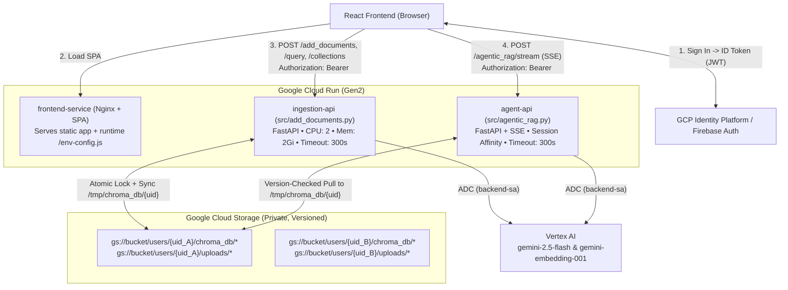

# GCP Deployment & Multi-Tenant Persistence Plan

This document is the reproducible blueprint for deploying **InteractiveRAG** to **Google Cloud Platform (GCP)** using **Cloud Run**, **Google Cloud Storage (GCS)**, **Identity Platform (Firebase Auth)**, **Vertex AI**, and **Terraform**.

---

## 1. Target Architecture



---

## 2. Key Architectural Decisions

### 2.1 Why Per-User `/tmp` + GCS Sync Instead of Raw GCS FUSE
- **SQLite Constraints**: `chromadb.PersistentClient` relies on SQLite (`chroma.sqlite3`) and memory-mapped HNSW index segments. GCS is an object store without POSIX byte-range locking; running SQLite directly over a GCS FUSE mount across two separate services (`ingestion-api` and `agent-api`) risks `database is locked` errors, index corruption, and stale in-memory caches.
- **Solution**: Each authenticated user gets a dedicated GCS prefix (`gs://<BUCKET>/users/<uid>/chroma_db/`). Cloud Run Gen2 provides an in-memory `tmpfs` at `/tmp`. Services sync only the active user's directory to `/tmp/chroma_db/<uid>/`, execute ChromaDB operations at local memory speed, and use a lightweight `version.json` marker + GCS generation-matched lock (`if_generation_match=0`) to keep `ingestion-api` and `agent-api` coherent.

### 2.2 Zero-Trust Multi-Tenant User Isolation
- **Identity Verification**: Users authenticate via **Google Cloud Identity Platform** (Firebase Auth). Every backend request carries `Authorization: Bearer <ID_TOKEN>`.
- **Server-Derived Scope**: A shared FastAPI dependency (`get_current_user`) verifies the JWT signature and extracts the immutable `uid`. Storage paths (`/tmp/chroma_db/{uid}` and `gs://<BUCKET>/users/{uid}/`) and LangGraph conversation threads (`{uid}:{thread_id}`) are derived strictly from this verified `uid`—never from client request bodies or query parameters.
- **Physical Vector Store Separation**: Because every user has a distinct SQLite file and HNSW directory, User A and User B can create collections with identical names (e.g., `stock_market_vs`) without collision or cross-tenant visibility.

### 2.3 Runtime Frontend Configuration (`/env-config.js`)
- Vite normally bakes `VITE_*` variables at `docker build` time, creating a circular dependency with Cloud Run URLs during Terraform provisioning.
- Instead, `docker/entrypoint-frontend.sh` generates `/usr/share/nginx/html/env-config.js` (`window.__ENV__`) at container startup from Cloud Run environment variables. Docker images are built **once**, and Terraform wires service URLs, CORS origins, and Identity Platform `authorized_domains` in a single pass.

---

## 3. Step-by-Step Implementation Checklist

### Phase 1: Reproducible IaC & Container Scaffolding
- [x] Create `docs/GCP_DEPLOYMENT_PLAN.md` architectural specification.
- [x] Create `.dockerignore`, `docker/Dockerfile.backend`, `docker/Dockerfile.frontend`, `docker/nginx.conf.template`, and `docker/entrypoint-frontend.sh`.
- [x] Create Terraform modules under `infra/` (`versions.tf`, `variables.tf`, `apis.tf`, `storage.tf`, `iam.tf`, `auth.tf`, `cloud_run.tf`, `outputs.tf`, `terraform.tfvars.example`).
- [x] Create `cloudbuild.yaml` and `Makefile` for reproducible bootstrap, image builds, and deployments.

### Phase 2: Backend Authentication Module (`utils/auth.py`)
- [x] Add `firebase-admin` and `google-cloud-storage` to `requirements.txt`.
- [x] Implement Firebase Admin initialization (using Cloud Run Application Default Credentials and `GOOGLE_CLOUD_PROJECT`).
- [x] Implement `get_current_user` FastAPI dependency:
  - Validate `Authorization: Bearer <token>` header.
  - Verify token with `firebase_admin.auth.verify_id_token(token, check_revoked=False)`.
  - Validate `uid` matches `^[a-zA-Z0-9_-]{1,128}$` to prevent path traversal.
  - Support an explicit local-only bypass (`AUTH_DISABLED=true` + `DEV_USER_ID=local-dev` **only** when `K_SERVICE` is unset) if needed for offline unit tests.

### Phase 3: Per-User GCS ↔ ChromaDB Storage Manager (`utils/chroma_storage.py`)
- [x] Configure `LOCAL_CHROMA_ROOT` (default `/tmp/chroma_db` in Cloud Run, `./chroma_db/users` locally) and `GCS_BUCKET_NAME`.
- [x] Implement `ensure_user_chroma_synced(uid: str) -> str` (Read Path):
  - When `GCS_BUCKET_NAME` is set, inspect `users/{uid}/chroma_db/version.json` in GCS.
  - Compare remote generation/version against `/tmp/chroma_db/{uid}/version.json`.
  - If missing or stale, reset cached Chroma client state for `uid`, download blobs under `users/{uid}/chroma_db/` into `/tmp/chroma_db/{uid}/`, and record the local version.
- [x] Implement `user_chroma_write_lock(uid: str)` context manager (Write Path):
  - Acquire `users/{uid}/locks/chroma.lock` in GCS using `if_generation_match=0` (with stale-lock TTL recovery if a previous container crashed).
  - Pull latest user snapshot via `ensure_user_chroma_synced(uid)`.
  - Yield the local `persist_directory` (`/tmp/chroma_db/{uid}`) for ChromaDB mutation.
  - Upload modified/new files in `/tmp/chroma_db/{uid}` to `users/{uid}/chroma_db/`, delete remote blobs removed locally (e.g., deleted collection HNSW folders), write updated `version.json`, and release `chroma.lock`.
- [x] Implement LRU `/tmp` eviction for inactive user directories when `/tmp` free space drops below threshold.

### Phase 4: Multi-Tenant Backend Hardening (`src/add_documents.py` & `src/agentic_rag.py`)
- [x] Inject `uid: str = Depends(get_current_user)` into all collection, ingestion, query, and agent endpoints.
- [x] Replace hardcoded `"chroma_db"` with the per-user path returned by `utils/chroma_storage.py`.
- [x] **Security fix in `POST /add_documents`**:
  - Disable arbitrary server-filesystem `pdf_paths` when running in Cloud Run (`K_SERVICE` set) so users cannot read container paths or other users' temp files.
  - Store uploaded multipart PDFs in an isolated per-request temp folder (`/tmp/uploads/{uid}/{uuid}/`), optionally archive raw PDFs to `gs://<BUCKET>/users/{uid}/uploads/`, and clean up `/tmp/uploads/{uid}/{uuid}/` in a `finally` block.
- [x] **Conversation state isolation in `src/agentic_rag.py`**:
  - Move `InMemorySaver()` to module scope so multi-turn conversations persist across warm requests.
  - Scope every `thread_id` with the verified user ID: `scoped_thread_id = f"{uid}:{request.thread_id}"`.
- [x] **Production server settings**:
  - Add unauthenticated `GET /health` endpoints to both FastAPI apps.
  - Read `ALLOWED_ORIGINS` from environment variables instead of `["*"]`.
  - Add `Cache-Control: no-cache` and `X-Accel-Buffering: no` headers to `StreamingResponse` in `src/agentic_rag.py`.
  - Disable `reload=True` unless `UVICORN_RELOAD=true`.

### Phase 5: Frontend Authentication & Runtime Config (`frontend/`)
- [x] Load `<script src="/env-config.js"></script>` in `frontend/index.html` (with fallback to `import.meta.env.VITE_*` for local `npm run dev`).
- [x] Install `firebase` in `frontend/package.json` and initialize Firebase Auth (`src/firebase.js`).
- [x] Add Login / Sign-Up (Google OAuth Sign-In + Email & Password) and user header bar with Sign Out in `frontend/src/AuthGate.jsx` & `frontend/src/App.jsx`.
- [x] Clear React collection/chat state on sign-out or account switch.
- [x] Add authenticated `authFetch` helper in `frontend/src/App.jsx` that attaches `Authorization: Bearer <ID_TOKEN>` to all REST and streaming `fetch` calls.

### Phase 6: Provision, Deploy & Verify on GCP
- [x] Configure `infra/terraform.tfvars` (`project_id = "interactive-rag"` + Google OAuth credentials via Secret Manager).
- [x] Run `make bootstrap` (enables seed APIs, creates Terraform remote state bucket & Artifact Registry).
- [x] Run `make build-push` (builds `linux/amd64` backend & frontend images via Cloud Build).
- [x] Run `make deploy` (executes `terraform apply` to deploy Identity Platform, GCS, IAM, auto-wired `FIREBASE_API_KEY`, and all 3 Cloud Run services).
- [x] Execute the Multi-Tenant Verification Playbook below.

---

## 4. Reproducible Deployment Commands

Prerequisites: `gcloud` CLI authenticated (`gcloud auth login` and `gcloud auth application-default login`) and `terraform >= 1.5`.

```bash
# 1. Copy example variables (pre-configured with project_id = "interactive-rag")
cp infra/terraform.tfvars.example infra/terraform.tfvars

# 2. Bootstrap Terraform state bucket + Artifact Registry
make bootstrap PROJECT_ID=interactive-rag

# 3. Build & push container images via Google Cloud Build
make build-push PROJECT_ID=interactive-rag

# 4. Provision all GCP resources & deploy Cloud Run services
make deploy PROJECT_ID=interactive-rag
```

---

## 5. Multi-Tenant Security Verification Playbook

1. **Unauthenticated Rejection**:
   ```bash
   curl -i https://<INGESTION_API_URL>/collections
   # Expected: HTTP/2 401 Unauthorized
   ```
2. **Strict Tenant Isolation**:
   - Sign in as **User A**, upload a PDF to collection `confidential_a`. Verify `confidential_a` appears in collections and answers queries.
   - Sign in as **User B** (incognito window). Verify collection list is empty (`[]`).
   - Using User B's JWT, send `POST /query` and `DELETE /collections/confidential_a` via `curl`. Verify `404 Not Found` and confirm User A's collection remains untouched.
3. **Cross-Service Sync Coherence**:
   - As **User A**, upload a new PDF to `confidential_a` (`ingestion-api`) and immediately query it in the Agentic RAG chat (`agent-api`). Confirm `version.json` sync pulls the newly indexed chunks into `agent-api`.
4. **Scale-to-Zero Durability**:
   - Deploy a new revision or wait for instances to scale to zero (clearing `/tmp`), sign back in as **User A**, and verify `confidential_a` reloads automatically from `gs://<BUCKET>/users/<uid_A>/chroma_db/`.
