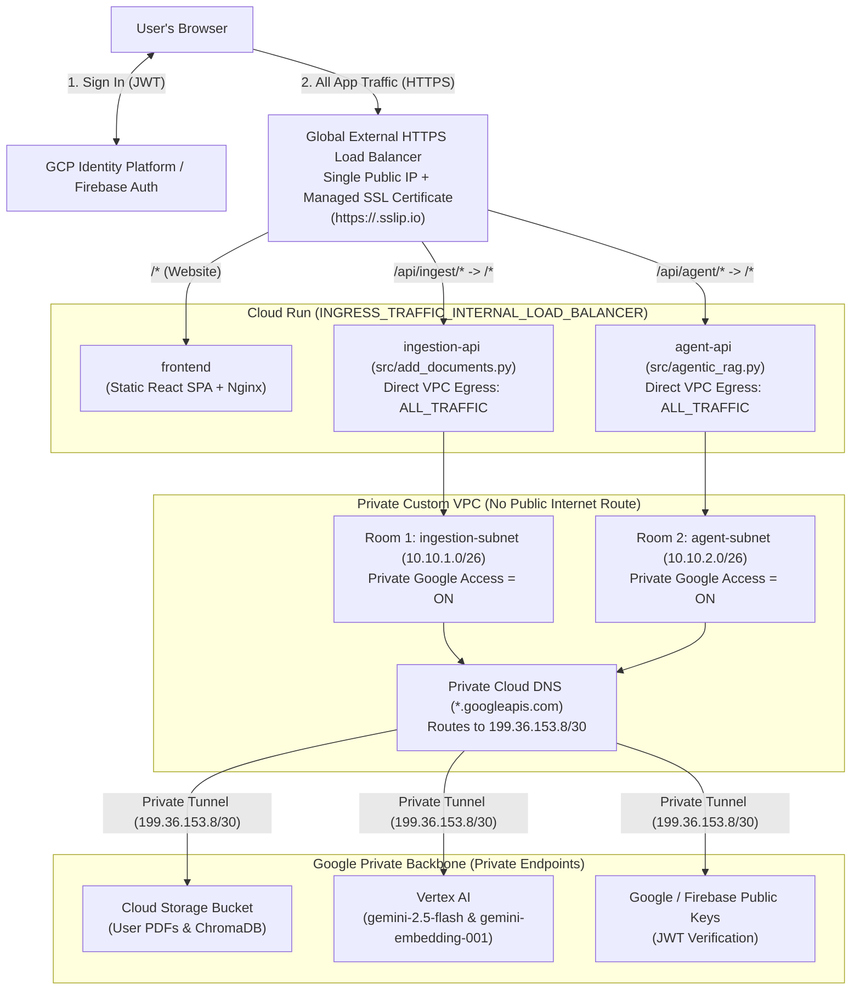

# Network Security & Load Balancer Plan (VPC, Segmentation & Private Endpoints)

This document is the step-by-step blueprint for upgrading **InteractiveRAG** on **Google Cloud Platform (GCP)** with:
1. **VPC Design** — A private virtual network with no public internet exit for backend containers.
2. **Network Segmentation + Load Balancer** — One public HTTPS front door (**Global External Application Load Balancer**), locking down direct internet access to all Cloud Run `*.run.app` URLs and separating backend workloads into dedicated subnets.
3. **Private Endpoints** — Private Google Access + Private Cloud DNS tunnels so all traffic to **Cloud Storage (PDFs & ChromaDB)**, **Vertex AI (Gemini & Embeddings)**, and **Firebase Auth** stays strictly on Google's private internal network.

---

## 1. Target Architecture (Before vs. After)

### Before
- All 3 Cloud Run apps (`frontend`, `ingestion-api`, `agent-api`) sit directly on the public internet (`INGRESS_TRAFFIC_ALL`).
- Backend containers have unrestricted outbound internet access over Google's default shared network.

### After
- **Only the Google Load Balancer is reachable from the public internet.**
- Direct visits to any `*.run.app` URL from the internet are blocked (`403 Forbidden`).
- `ingestion-api` and `agent-api` sit in separate private rooms (subnets) with **zero outbound internet access**, reaching Google Storage, Gemini, and Firebase exclusively through a private internal tunnel.



---

## 2. Key Design Decisions (In Plain English)

### 2.1 Private Building With No Internet Exit (VPC Design)
- We create a custom VPC (`auto_create_subnetworks = false`) and remove the default route to the open internet (`delete_default_routes_on_create = true`).
- We attach `ingestion-api` and `agent-api` to this VPC using **Cloud Run Direct VPC Egress (`ALL_TRAFFIC`)**, which costs **$0/month** when idle (no connector VMs required).
- Even if a malicious uploaded PDF tried to trick the server into sending files to an outside website, the connection fails because there is no route to the public internet.
- We also set `ANONYMIZED_TELEMETRY=FALSE` on backend containers so ChromaDB never wastes time trying to send anonymous usage pings to external internet analytics servers.

### 2.2 Public Lobby vs. Private Back Rooms (Network Segmentation + Load Balancer)
- **Single Front Door**: A **Global External Application Load Balancer (`EXTERNAL_MANAGED`)** receives all user traffic over HTTPS and routes it by URL path:
  - `/api/ingest/*` $\rightarrow$ strips `/api/ingest` and forwards internally to `ingestion-api`.
  - `/api/agent/*` $\rightarrow$ strips `/api/agent` and forwards internally to `agent-api`.
  - Everything else (`/*`) $\rightarrow$ forwards internally to `frontend`.
- **Same-Origin Simplicity**: Because the Website (`frontend`), PDF Uploader (`/api/ingest`), and AI Chat (`/api/agent`) now share the **exact same HTTPS domain**, `frontend` simply receives `INGESTION_API_URL="/api/ingest"` and `AGENT_API_URL="/api/agent"`. Existing code in `frontend/src/firebase.js` already supports relative paths—**no React code changes required**.
- **Separate Internal Rooms**: `ingestion-api` (which parses untrusted user PDFs) lives in `ingestion-subnet` (`10.10.1.0/26`), isolated from `agent-api` in `agent-subnet` (`10.10.2.0/26`). (`/26` provides 64 internal IPs per subnet, matching Cloud Run Direct VPC Egress scaling requirements.)

### 2.3 Private Underground Tunnel to Google (Private Endpoints)
- Both subnets enable **Private Google Access** (`private_ip_google_access = true`) with a dedicated VPC route only to Google's private VIP range (`199.36.153.8/30` — `private.googleapis.com`).
- A **Private Cloud DNS** zone for `googleapis.com.` maps `*.googleapis.com` to `199.36.153.8–11`.
- Why `private.googleapis.com` is chosen: In addition to **Cloud Storage** (`storage.googleapis.com`) and **Vertex AI** (`*-aiplatform.googleapis.com`), Firebase Admin's `verify_id_token()` fetches public signing keys from `www.googleapis.com`, which works seamlessly over `private.googleapis.com` without internet access.

### 2.4 Free Automatic HTTPS Certificate (`sslip.io` — No Custom Domain Needed)
- Google-managed SSL certificates and Firebase Login both require an HTTPS hostname (not a raw IP address).
- Terraform automatically builds `<LB_IP_WITH_DASHES>.sslip.io` (e.g., `34-120-10-25.sslip.io`) directly from the Load Balancer's reserved static IP. `sslip.io` is a free public wildcard DNS service that automatically resolves that hostname back to your Load Balancer IP, allowing Google Cloud to automatically issue and renew a trusted HTTPS certificate at zero cost.

---

## 3. Step-by-Step Implementation Phases

### Phase 1: Enable Networking APIs & Deployer Permissions
- [x] Add `compute.googleapis.com` and `dns.googleapis.com` to `infra/apis.tf` and the `bootstrap` target in `Makefile`.
- [x] Add networking & DNS IAM roles (`roles/compute.networkAdmin`, `roles/compute.loadBalancerAdmin`, `roles/compute.securityAdmin`, `roles/dns.admin`) to `TF_DEPLOYER_ROLES` in `Makefile` so automated Terraform deploys can manage VPC, DNS, and Load Balancer resources.
- [x] Add `ingestion_subnet_cidr` and `agent_subnet_cidr` variables to `infra/variables.tf` and `infra/terraform.tfvars.example`.

### Phase 2: Build the Private VPC & Segmented Subnets (Concepts 1 & 2)
- [x] Create `infra/network.tf`:
  - Provision custom VPC `google_compute_network.main` with `auto_create_subnetworks = false` and `delete_default_routes_on_create = true` (eliminating outbound public internet access).
  - Provision `ingestion-subnet` (`10.10.1.0/26`) in `var.region` with `private_ip_google_access = true`.
  - Provision `agent-subnet` (`10.10.2.0/26`) in `var.region` with `private_ip_google_access = true`.

### Phase 3: Configure Private Endpoints & Private Cloud DNS (Concept 3)
- [x] In `infra/network.tf`:
  - Add a static VPC route (`google_compute_route.private_googleapis`) sending `199.36.153.8/30` to `default-internet-gateway` (Google's internal next-hop for Private Google Access).
  - Create a private Cloud DNS zone (`google_dns_managed_zone.googleapis`, `dns_name = "googleapis.com."`, `visibility = "private"`) bound to `google_compute_network.main`.
  - Add DNS `A` record `private.googleapis.com.` $\rightarrow$ `["199.36.153.8", "199.36.153.9", "199.36.153.10", "199.36.153.11"]`.
  - Add DNS `CNAME` record `*.googleapis.com.` $\rightarrow$ `private.googleapis.com.`.

### Phase 4: Provision the Global External HTTPS Load Balancer (Concept 2)
- [x] Create `infra/load_balancer.tf`:
  - Reserve a global static IPv4 address (`google_compute_global_address.lb_ip`).
  - Derive the automatic Load Balancer hostname `"${replace(google_compute_global_address.lb_ip.address, ".", "-")}.sslip.io"`.
  - Create a Google-managed SSL certificate (`google_compute_managed_ssl_certificate.lb_cert`) for that `sslip.io` hostname.
  - Create 3 Serverless Network Endpoint Groups (`google_compute_region_network_endpoint_group`) pointing to `frontend`, `ingestion_api`, and `agent_api`.
  - Create 3 Backend Services (`google_compute_backend_service` with `load_balancing_scheme = "EXTERNAL_MANAGED"`).
  - Create the HTTPS URL Map (`google_compute_url_map.https_router`) routing:
    - `/api/ingest/*` $\rightarrow$ `ingestion` backend service (rewriting prefix `/api/ingest/` to `/`).
    - `/api/agent/*` $\rightarrow$ `agent` backend service (rewriting prefix `/api/agent/` to `/`).
    - Default (`/*`) $\rightarrow$ `frontend` backend service.
  - Attach `google_compute_target_https_proxy` + port `443` `google_compute_global_forwarding_rule`.
  - Add an HTTP (`80`) URL map + `google_compute_target_http_proxy` + port `80` forwarding rule that automatically 301-redirects `http://` visitors to `https://`.

### Phase 5: Lock Down Cloud Run & Wire Frontend / Auth
- [ ] Update `infra/cloud_run.tf`:
  - Change `ingress` on `frontend`, `ingestion_api`, and `agent_api` from `"INGRESS_TRAFFIC_ALL"` to `"INGRESS_TRAFFIC_INTERNAL_LOAD_BALANCER"`.
  - Attach `vpc_access` (`egress = "ALL_TRAFFIC"`) to `ingestion_api` (`ingestion-subnet`) and `agent_api` (`agent-subnet`).
  - Add `ANONYMIZED_TELEMETRY = "FALSE"` to `ingestion_api` and `agent_api` environment variables.
  - Set `frontend` environment variables to same-origin Load Balancer paths: `INGESTION_API_URL = "/api/ingest"` and `AGENT_API_URL = "/api/agent"`.
  - Update `ALLOWED_ORIGINS` to include the Load Balancer `https://` URL.
- [ ] Update `infra/auth.tf`:
  - Add the Load Balancer `sslip.io` domain to Identity Platform `authorized_domains` so Firebase Sign-In works immediately on the new domain.
- [ ] Update `infra/outputs.tf`:
  - Output `load_balancer_ip` and `load_balancer_url` (`https://<IP-with-dashes>.sslip.io`) as the primary entry point.

### Phase 6: Deploy & Verify End-to-End
- [ ] Run `make bootstrap` to enable `compute` & `dns` APIs and update deployer IAM roles.
- [ ] Run `make plan` and `make deploy` to provision the VPC, Private Endpoints, Load Balancer, and locked-down Cloud Run revisions.
- [ ] *(If using Google Sign-In OAuth)* Add the new `https://<IP-with-dashes>.sslip.io` URL under **APIs & Services $\rightarrow$ Credentials $\rightarrow$ OAuth 2.0 Web Client $\rightarrow$ Authorized JavaScript origins** in the GCP Console.
- [ ] Wait ~10–15 minutes on first creation for the Google-managed SSL certificate status to reach `ACTIVE`, then execute the verification playbook below.

---

## 4. Files to Create / Modify

| File | Action | Purpose |
| :--- | :--- | :--- |
| `Makefile` | Modify | Enable `compute` & `dns` APIs; add network/LB/DNS roles to deployer SA |
| `infra/apis.tf` | Modify | Track `compute.googleapis.com` and `dns.googleapis.com` in Terraform |
| `infra/variables.tf` | Modify | Add `ingestion_subnet_cidr` and `agent_subnet_cidr` |
| `infra/terraform.tfvars.example` | Modify | Document subnet CIDR settings |
| `infra/network.tf` | **Create** | Custom VPC (no internet route), segmented subnets, Private Google Access route, and Private Cloud DNS (`*.googleapis.com`) |
| `infra/load_balancer.tf` | **Create** | Static IP, `sslip.io` Managed SSL cert, 3 Serverless NEGs, 3 Backend Services, `/api/ingest/*` & `/api/agent/*` URL rewrites, HTTPS + HTTP-redirect proxies |
| `infra/cloud_run.tf` | Modify | Lock `ingress` to Load Balancer only, attach Direct VPC Egress (`ALL_TRAFFIC`), wire `/api/ingest` & `/api/agent`, disable Chroma telemetry |
| `infra/auth.tf` | Modify | Authorize the Load Balancer `sslip.io` domain in Identity Platform |
| `infra/outputs.tf` | Modify | Expose `load_balancer_url` and `load_balancer_ip` |

---

## 5. Security & Connectivity Verification Playbook

1. **Verify Direct Cloud Run URLs Are Blocked (Network Segmentation)**
   ```bash
   # Fetching raw *.run.app URLs directly from the internet must now be forbidden:
   curl -i "$(terraform -chdir=infra output -raw ingestion_api_url)/health"
   curl -i "$(terraform -chdir=infra output -raw agent_api_url)/health"
   curl -i "$(terraform -chdir=infra output -raw frontend_service_uri)/healthz"
   # Expected on all 3: HTTP 403 Forbidden (or Google Front End access denied page)
   ```

2. **Verify SSL Certificate Status & Single Public Front Door**
   ```bash
   LB_URL="$(terraform -chdir=infra output -raw load_balancer_url)"
   curl -i "${LB_URL}/healthz"
   curl -i "${LB_URL}/api/ingest/health"
   curl -i "${LB_URL}/api/agent/health"
   # Expected on all 3: HTTP/2 200 OK
   ```

3. **Verify Unauthenticated API Calls Still Require Login**
   ```bash
   curl -i "${LB_URL}/api/ingest/collections"
   # Expected: HTTP/2 401 Unauthorized
   ```

4. **Verify Private Tunnel to Storage & Vertex AI (End-to-End UI Check)**
   - Open `${LB_URL}` in your browser and sign in.
   - Upload a PDF into a collection (proves `ingestion-api` reaches **Cloud Storage** and **Vertex AI Embeddings** privately over `199.36.153.8/30` with zero internet access).
   - Ask a question in **Agentic RAG Chat** (proves `agent-api` verifies Firebase JWT keys, syncs ChromaDB from **Cloud Storage**, and streams **Gemini** responses through the Load Balancer).
